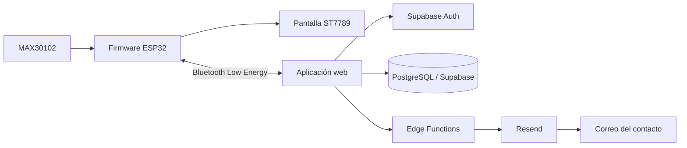

# A.M.A.R. — Documentación general

> **Nombre oficial:** A.M.A.R. — **Asistente de Monitoreo Autónomo de Ritmo**.  
> **Estado:** prototipo académico de hardware + aplicación web.  
> **Repositorio:** [Tomicasgit/Aplicacion_AMAR](https://github.com/Tomicasgit/Aplicacion_AMAR).

A.M.A.R. es un prototipo pensado para registrar y visualizar mediciones de frecuencia cardíaca, conservar un historial consultable y facilitar que una persona solicite ayuda y notifique a sus contactos configurados. El sistema combina un dispositivo basado en ESP32 y sensor óptico MAX30102 con una aplicación web responsive.

**A.M.A.R. no diagnostica, no predice por sí solo un evento médico y no reemplaza un profesional, un electrocardiograma ni los servicios de emergencia.** Las mediciones y los estados mostrados dependen de la calidad del sensor, el firmware, la conexión y la configuración del sistema.

## Índice de documentación

| Documento | Qué explica |
|---|---|
| [Idea, alcance y requisitos](docs/01-PROYECTO-Y-ALCANCE.md) | Problema, propuesta, usuarios, objetivos, límites y flujo funcional. |
| [Arquitectura y estructura](docs/02-ARQUITECTURA.md) | Componentes, flujo de datos, carpetas y responsabilidades. |
| [Aplicación web](docs/03-APLICACION-WEB.md) | HTML, CSS, cada módulo JavaScript, navegación y eventos. |
| [Hardware y firmware](docs/04-HARDWARE-Y-FIRMWARE.md) | Placa, sensor, pantalla, pines, lectura, BLE y formato de datos. |
| [Backend, datos y seguridad](docs/05-BACKEND-DATOS-Y-SEGURIDAD.md) | Supabase, tablas usadas, autenticación, Edge Functions, correo y secretos. |
| [Diseño y paleta](docs/06-DISENO-Y-PALETA.md) | Sistema visual, códigos hexadecimales, componentes y accesibilidad. |
| [Pruebas, límites y cronología](docs/07-PRUEBAS-LIMITES-Y-CRONOLOGIA.md) | Qué verificar, limitaciones conocidas, mantenimiento y tiempo de desarrollo documentable. |
| [Referencia completa de colores](README-PALETA.md) | Tabla de color y reglas de uso. |

## Vista rápida del sistema

El enlace BLE transporta lecturas del dispositivo a la web. Supabase se usa para autenticación y persistencia. La función `amar-sos` registra una alerta y, si está configurado Resend y existen destinatarios, intenta enviar un correo. La función `amar-email` permite enviar una plantilla a un contacto concreto cuando se utiliza ese flujo.

## Funciones principales

- Crear una cuenta e iniciar/cerrar sesión.
- Configurar un perfil personal.
- Vincular el dispositivo compatible por Bluetooth.
- Ver las LPM recibidas, el estado de conexión y la hora de la última lectura.
- Guardar y consultar mediciones e historial por fecha.
- Gestionar dispositivos y contactos de emergencia.
- Registrar una solicitud SOS manual y gestionar una alerta automática del flujo implementado.
- Adjuntar ubicación cuando el usuario concede permiso y el navegador la obtiene.
- Notificar contactos por correo mediante el backend cuando la configuración está activa.
- Abrir el teléfono o WhatsApp para que la persona complete la comunicación manualmente.

## Stack tecnológico

| Capa | Tecnología | Responsabilidad |
|---|---|---|
| Interfaz | HTML5 | Estructura semántica de vistas, paneles, formularios y modales. |
| Presentación | CSS3 | Diseño responsive, estados, animaciones y paleta. |
| Lógica cliente | JavaScript | Navegación SPA, validación, CRUD, historial, BLE y SOS. |
| Autenticación y datos | Supabase Auth + PostgreSQL | Identidad, acceso a datos y persistencia. |
| Funciones de servidor | Supabase Edge Functions / Deno | Lógica protegida de alertas y correo. |
| Envío de correo | Resend API | Transporte de mensajes desde el servidor. |
| Dispositivo | Arduino/C++ sobre ESP32 | Lectura del MAX30102, pantalla y servidor BLE. |
| Pantalla del dispositivo | ST7789, 170 × 320 | Estado local del sensor y del prototipo. |
| Sensor | MAX30102 | Sensor óptico usado para estimar la frecuencia del pulso. |

## Principios del proyecto

1. **Separación de responsabilidades:** sensor y firmware adquieren/procesan; la web presenta y registra; Supabase autentica y persiste; las funciones del servidor realizan operaciones protegidas.
2. **Privacidad:** no se debe incluir una clave privada de Resend ni secretos del servidor en JavaScript público.
3. **Permisos explícitos:** ubicación y Bluetooth dependen del navegador, del sistema operativo y de la autorización del usuario.
4. **Transparencia:** la interfaz debe distinguir una alerta registrada, un correo aceptado por el proveedor y una comunicación humana efectivamente recibida.
5. **Accesibilidad:** no depender exclusivamente del color y respetar la preferencia de movimiento reducido.
6. **Alcance sanitario prudente:** una lectura aislada o un estado visual no constituye diagnóstico.

## Configuración resumida

La web carga la configuración pública de Supabase desde `supabase-config.js`. La URL y la clave *anon/publishable* son valores de cliente; la seguridad de los datos debe estar reforzada con políticas RLS. Las claves privadas deben permanecer como secretos del proyecto Supabase.

Para envío de correo mediante Resend, configurar los secretos del proyecto y desplegar las funciones correspondientes. Ver [Backend, datos y seguridad](docs/05-BACKEND-DATOS-Y-SEGURIDAD.md).

## Documentación del tiempo de desarrollo

El historial de trabajo documentado permite situar avances funcionales durante **octubre de 2026**, con cambios de firmware, Bluetooth, historial, SOS y correo. El repositorio por sí solo no demuestra las horas efectivas de trabajo; por eso no se inventa una cantidad de horas. El documento [Pruebas, límites y cronología](docs/07-PRUEBAS-LIMITES-Y-CRONOLOGIA.md) diferencia las fechas de actividad que pueden respaldarse del tiempo efectivo que requiere un registro horario.

## Aviso importante

Este proyecto es un prototipo académico. No debe usarse como único mecanismo de seguridad, no sustituye atención profesional y no garantiza que un contacto lea o responda un correo. Ante una emergencia real, contactar directamente al servicio de emergencias local.
