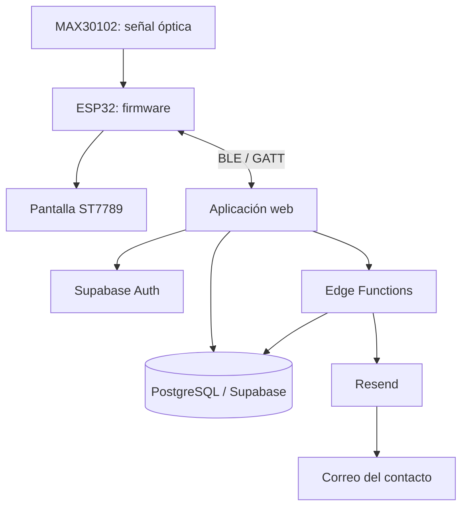

# A.M.A.R. — Documentación maestra del proyecto

> **Nombre del proyecto:** A.M.A.R. — **Alerta de Latidos y Monitoreo Autónomo**.  
> **Tipo:** prototipo académico integrado de hardware y aplicación web.  
> **Repositorio web:** [Tomicasgit/Aplicacion_AMAR](https://github.com/Tomicasgit/Aplicacion_AMAR)  
> **Repositorio del firmware vigente:** [Tomicasgit/ESP32_Proyecto2030](https://github.com/Tomicasgit/ESP32_Proyecto2030), sketch que declara v5.3.  
> **Nota de compatibilidad:** la copia `Completop.ino` de este repositorio web declara v4.1 y es histórica; no es la fuente de verdad del dispositivo actual.  
> **Estado de la documentación:** guía funcional, técnica, de operación, seguridad, pruebas y uso.

> **¿Querés explorar todas las mejoras posibles y cómo implementarlas?** Consultá el [Catálogo integral de mejoras y hoja de ruta](README-MEJORAS.md), un documento independiente con propuestas de frontend, UX, BLE, firmware, seguridad, datos, SOS, pruebas, despliegue, investigación y un plan de ejecución por etapas.

A.M.A.R. es un prototipo que combina un dispositivo basado en ESP32 y sensor óptico MAX30102 con una aplicación web. Su propósito es estimar y mostrar latidos por minuto (LPM), conservar lecturas recibidas para consultar su evolución y facilitar una solicitud SOS con notificación a contactos configurados cuando los servicios de servidor y correo están activos.

**Límite fundamental:** A.M.A.R. no es un dispositivo médico certificado, no diagnostica ni descarta enfermedades, no sustituye una consulta médica, un ECG, un tratamiento ni los servicios de emergencia. La calidad de una lectura depende del sensor, el contacto, el movimiento, el firmware, la conexión y las condiciones de uso.

---

## 1. Empieza por aquí

| Si necesitás… | Leé… |
|---|---|
| Entender la idea sin entrar en código | [01 — Proyecto y alcance](docs/01-PROYECTO-Y-ALCANCE.md) |
| Entender cómo se conecta todo | [02 — Arquitectura](docs/02-ARQUITECTURA.md) |
| Saber qué hace cada archivo | [09 — Catálogo del código](docs/09-CATALOGO-DE-CODIGO.md) |
| Comprender el dispositivo y los parámetros | [04 — Hardware y firmware](docs/04-HARDWARE-Y-FIRMWARE.md), [17 — Referencia del firmware](docs/17-REFERENCIA-FIRMWARE.md) y [24 — Lógica completa de firmware v5.3](docs/24-REFERENCIA-FIRMWARE-V5.3.md) |
| Comprender tablas y datos | [08 — Diccionario de datos](docs/08-DICCIONARIO-DE-DATOS.md) |
| Comprender el SOS y el correo | [05 — Backend y seguridad](docs/05-BACKEND-DATOS-Y-SEGURIDAD.md) y [10 — Contratos y flujos API](docs/10-CONTRATOS-Y-FLUJOS-API.md) |
| Usar la aplicación | [18 — Manual de usuario](docs/18-MANUAL-DE-USUARIO.md) |
| Instalar o publicar | [12 — Instalación y despliegue](docs/12-INSTALACION-DESPLIEGUE-Y-OPERACION.md) |
| Investigar un problema | [19 — Manual de mantenimiento](docs/19-MANUAL-DE-MANTENIMIENTO.md) |
| Preparar y documentar pruebas | [14 — Plan de pruebas](docs/14-PLAN-DE-PRUEBAS-Y-ACEPTACION.md) |
| Consultar colores y criterios visuales | [06 — Diseño y paleta](docs/06-DISENO-Y-PALETA.md) y [README-PALETA.md](README-PALETA.md) |

## 2. Índice completo de documentación

Los documentos están numerados para facilitar su lectura en orden. Las afirmaciones técnicas describen el código consultado; los detalles que dependen del proyecto desplegado (por ejemplo, tipos SQL, políticas RLS o entrega final de correo) deben verificarse en ese entorno. La referencia 24 documenta el firmware v5.3 del repositorio canónico separado; la copia v4.1 que permanece en este repositorio es histórica.

| N.º | Documento | Contenido |
|---:|---|---|
| 01 | [Proyecto y alcance](docs/01-PROYECTO-Y-ALCANCE.md) | Idea, necesidad, objetivos, usuarios, alcance, ética y límites. |
| 02 | [Arquitectura](docs/02-ARQUITECTURA.md) | Capas, diagramas, estructura de carpetas y flujo de datos. |
| 03 | [Aplicación web](docs/03-APLICACION-WEB.md) | HTML, CSS, módulos JS, navegación, Bluetooth y errores. |
| 04 | [Hardware y firmware](docs/04-HARDWARE-Y-FIRMWARE.md) | ESP32, MAX30102, pantalla, pines, BLE y pruebas físicas. |
| 05 | [Backend, datos y seguridad](docs/05-BACKEND-DATOS-Y-SEGURIDAD.md) | Supabase, tablas, Edge Functions, Resend, RLS y secretos. |
| 06 | [Diseño y paleta](docs/06-DISENO-Y-PALETA.md) | Identidad visual, HEX, jerarquía, responsive y accesibilidad. |
| 07 | [Pruebas, límites y cronología](docs/07-PRUEBAS-LIMITES-Y-CRONOLOGIA.md) | Checklist, limitaciones y períodos de trabajo documentados. |
| 08 | [Diccionario de datos](docs/08-DICCIONARIO-DE-DATOS.md) | Entidades, campos observados, tablas y pendientes de esquema. |
| 09 | [Catálogo del código](docs/09-CATALOGO-DE-CODIGO.md) | Responsabilidad de cada archivo y sus funciones principales. |
| 10 | [Contratos y flujos API](docs/10-CONTRATOS-Y-FLUJOS-API.md) | BLE, Supabase, Edge Functions, estados de correo y errores. |
| 11 | [Diseño UX y accesibilidad](docs/11-DISENO-UX-Y-ACCESIBILIDAD.md) | Navegación, estados, contactos, SOS, responsive y pruebas de uso. |
| 12 | [Instalación, despliegue y operación](docs/12-INSTALACION-DESPLIEGUE-Y-OPERACION.md) | Requisitos, servidor estático, Supabase, Resend, firmware y diagnóstico. |
| 13 | [Seguridad, privacidad y riesgos](docs/13-SEGURIDAD-PRIVACIDAD-Y-RIESGOS.md) | Activos, amenazas, RLS, datos sensibles y mitigaciones. |
| 14 | [Plan de pruebas y aceptación](docs/14-PLAN-DE-PRUEBAS-Y-ACEPTACION.md) | Casos AUTH, contactos, BLE, historial, SOS, correo y aceptación. |
| 15 | [Decisiones técnicas y cambios](docs/15-DECISIONES-TECNICAS-Y-CAMBIOS.md) | Decisiones de arquitectura, historial y plantilla de bitácora. |
| 16 | [Glosario y referencias](docs/16-GLOSARIO-Y-REFERENCIAS.md) | Terminología y documentación primaria de las tecnologías. |
| 17 | [Referencia del firmware](docs/17-REFERENCIA-FIRMWARE.md) | Fuente canónica v5.3 y distinción respecto de la copia histórica v4.1. |
| 18 | [Manual de usuario](docs/18-MANUAL-DE-USUARIO.md) | Cómo acceder, conectar, leer, consultar historial, contactos y SOS. |
| 19 | [Manual de mantenimiento](docs/19-MANUAL-DE-MANTENIMIENTO.md) | Diagnóstico por capas, publicación, recuperación y evidencia. |
| 20 | [HTML, CSS y componentes](docs/20-HTML-CSS-Y-COMPONENTES.md) | Identificadores del HTML, cascada CSS, componentes y variables de diseño. |
| 21 | [Memoria descriptiva académica](docs/21-MEMORIA-DESCRIPTIVA-PARA-PRESENTACION.md) | Resumen no técnico, objetivos, metodología, evaluación y trabajo futuro. |
| 22 | [Requisitos funcionales y no funcionales](docs/22-REQUISITOS-FUNCIONALES-Y-NO-FUNCIONALES.md) | Matriz de requisitos, actores y casos de uso. |
| 23 | [Pendientes y deuda técnica](docs/23-PENDIENTES-Y-DEUDA-TECNICA.md) | Validaciones pendientes, riesgos, prioridades y definición de terminado. |
| 24 | [Referencia completa del firmware v5.3](docs/24-REFERENCIA-FIRMWARE-V5.3.md) | Lógica del sensor, filtros, estados, calidad, alertas internas, pantalla, reloj, BLE y ciclo principal. |
| 25 | [Estado actual y bitácora técnica](docs/25-ESTADO-ACTUAL-Y-BITACORA.md) | Arquitectura vigente, separación de repositorios, cambios recientes, verificación y pendientes. |
| — | [Índice de la carpeta docs](docs/README.md) | Navegación dentro de la documentación. |
| — | [Referencia rápida de colores](README-PALETA.md) | Paleta visual resumida. |

## 3. Cómo funciona el sistema



1. El MAX30102 genera muestras ópticas.
2. El firmware procesa la señal, estima LPM, valida antigüedad/estado y actualiza la pantalla.
3. El ESP32 publica un mensaje BLE.
4. La web recibe el mensaje, actualiza el panel y, cuando corresponde, guarda la lectura.
5. El usuario consulta el historial almacenado.
6. Si se solicita SOS, la web invoca el servidor; la función valida sesión, registra la alerta y puede solicitar a Resend el envío de correo.
7. El correo aceptado por el proveedor no garantiza entrega a bandeja, lectura ni respuesta.

## 4. Tecnologías y responsabilidades

| Capa | Tecnología | Responsabilidad |
|---|---|---|
| Estructura web | HTML5 | Vistas, formularios, tarjetas y diálogos. |
| Presentación | CSS3 | Paleta, layout, estados, responsive y animaciones. |
| Lógica cliente | JavaScript | Navegación, CRUD, historial, BLE, validación y SOS. |
| Autenticación | Supabase Auth | Identidad y sesión. |
| Persistencia | PostgreSQL mediante Supabase | Datos de perfil, lecturas, dispositivos, contactos, ubicaciones y alertas. |
| Operaciones protegidas | Supabase Edge Functions / Deno | Registro SOS y lógica de correo del servidor. |
| Correo | Resend API | Procesamiento de solicitudes de envío. |
| Firmware | Arduino/C++ en ESP32 | Sensor, estimación, pantalla y servidor BLE. |
| Sensor | MAX30102 | Fuente óptica de datos relacionados con el pulso. |
| Pantalla | ST7789, 170 × 320 | Estado y lectura local del dispositivo. |

## 5. Estructura principal del repositorio

```text
Aplicacion_AMAR/
├── index.html
├── style.css
├── supabase-config.js
├── app.js
├── Completop.ino              # copia histórica v4.1; firmware canónico en ESP32_Proyecto2030
├── package.json / package-lock.json
├── README.md
├── README-PALETA.md
├── js/
│   ├── core.js
│   ├── auth.js
│   ├── dashboard.js
│   ├── bluetooth.js
│   ├── devices.js
│   ├── contacts.js
│   ├── history.js
│   ├── profile.js
│   └── alerts.js
├── supabase/
│   ├── config.toml
│   └── functions/
│       ├── amar-email/index.ts
│       └── amar-sos/index.ts
└── docs/
    ├── 01…19 documentos especializados
```

Para la descripción archivo por archivo y las dependencias de carga, consultar [09 — Catálogo del código](docs/09-CATALOGO-DE-CODIGO.md). El árbol se debe actualizar si se agregan, eliminan o renombran archivos. El firmware vigente y su documentación de montaje se mantienen en [ESP32_Proyecto2030](https://github.com/Tomicasgit/ESP32_Proyecto2030); la lógica está explicada en [24 — Referencia completa del firmware v5.3](docs/24-REFERENCIA-FIRMWARE-V5.3.md).

## 6. Funciones de usuario

- Crear cuenta, iniciar sesión y cerrar sesión.
- Consultar el dashboard y el estado de la conexión.
- Vincular un dispositivo compatible por BLE.
- Mostrar la lectura recibida en LPM y su hora.
- Guardar lecturas para consultar el historial.
- Administrar perfil, dispositivos y contactos de emergencia.
- Consultar calendario y resúmenes de lecturas.
- Solicitar una alerta SOS y, con permisos disponibles, adjuntar ubicación.
- Intentar notificar contactos por correo desde el servidor si Resend está configurado.
- Abrir teléfono/WhatsApp para que el usuario complete la comunicación manualmente.

En “Mis contactos de emergencia”, las acciones son **Llamar**, **Editar** y **Eliminar**. El botón **Correo** fue retirado porque abría un enlace `mailto:` y dependía de una aplicación local. La dirección de correo se conserva como dato para el flujo SOS del servidor.

## 7. Configuración resumida

### Frontend
La aplicación carga la URL de Supabase y la clave pública desde `supabase-config.js`. Esa clave no es una clave administrativa: la protección real de las filas depende de RLS y de la autorización del servidor.

### Edge Functions y Resend
Los secretos privados se configuran en Supabase, no en archivos públicos:

```bash
supabase secrets set RESEND_API_KEY=tu_clave_resend RESEND_FROM_EMAIL="A.M.A.R. <alertas@tu-dominio.com>"
supabase functions deploy amar-sos
supabase functions deploy amar-email
```

Usar un remitente autorizado por Resend y un proyecto Supabase correcto. Los pasos completos están en [12 — Instalación y despliegue](docs/12-INSTALACION-DESPLIEGUE-Y-OPERACION.md).

## 8. Seguridad, privacidad y límites médicos

- RLS debe limitar cada tabla al usuario propietario; el filtrado en JavaScript no es suficiente.
- No guardar claves privadas, tokens o credenciales administrativas en GitHub.
- La ubicación es sensible y depende del permiso del usuario.
- El correo no es un canal garantizado de emergencia.
- El estado de la aplicación no prueba por sí solo que un contacto recibió ayuda.
- La onda animada es decorativa, no un ECG.
- El algoritmo de LPM no está clínicamente validado en este repositorio.
- No usar el prototipo para diagnosticar ni tomar decisiones de tratamiento.

Ver [13 — Seguridad y riesgos](docs/13-SEGURIDAD-PRIVACIDAD-Y-RIESGOS.md).

## 9. Verificación antes de una demostración

- [ ] Acceso y cierre de sesión.
- [ ] CRUD de perfil, dispositivos y contactos.
- [ ] Prueba de acceso cruzado con dos usuarios de prueba.
- [ ] Conexión BLE y desconexión.
- [ ] Lectura válida y dato obsoleto.
- [ ] Persistencia e historial.
- [ ] SOS sin ubicación.
- [ ] SOS con correo configurado y sin configurar.
- [ ] Revisión de eventos de Resend, sin asumir que “aceptado” equivale a “leído”.
- [ ] Prueba móvil y escritorio.
- [ ] Firmware, commit y entorno desplegado anotados.

La matriz completa está en [14 — Plan de pruebas](docs/14-PLAN-DE-PRUEBAS-Y-ACEPTACION.md).

## 10. Cronología y horas de trabajo

El contexto documentado sitúa avances de firmware, interfaz, Bluetooth, historial y SOS durante septiembre y octubre de 2026. El historial de Git y las conversaciones permiten registrar fechas de hitos, pero **no demuestran el total de horas efectivas trabajadas**. Para informar una cifra académica, completar la bitácora con hora de inicio, fin, actividad y evidencia real. No se debe calcular tiempo de trabajo a partir del número de commits.

## 11. Criterio de documentación viva

Cuando cambie algo, actualizar los documentos relacionados en el mismo cambio:
- Pines, umbrales o algoritmo → docs 04 y 17.
- Mensaje BLE o UUID → docs 02, 10 y 17, además de firmware/cliente.
- Tabla/columna o política → docs 05, 08 y 13.
- Botón o interacción → docs 03, 06 y 11.
- SOS/correo → docs 05, 10, 13 y 14.
- Requisitos de instalación → docs 12 y 19.
- Decisión arquitectónica → docs 15.

## 12. Aviso importante

Este repositorio describe un prototipo académico, no un dispositivo médico certificado. Ante una emergencia real, contactar directamente a los servicios de emergencia locales. No depender de A.M.A.R. como único mecanismo de seguridad.
