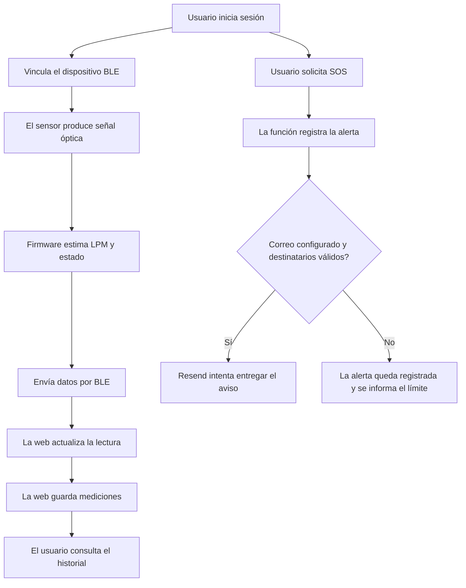

# 01 — Idea, alcance y requisitos de A.M.A.R.

## 1. Nombre y concepto

**A.M.A.R. significa Asistente de Monitoreo Autónomo de Ritmo.** Es una propuesta de sistema wearable + aplicación para acompañar el seguimiento de la frecuencia cardíaca mediante lecturas de un sensor óptico, historial y herramientas de notificación.

El término “autónomo” describe el funcionamiento del prototipo y su lectura local; no significa autonomía clínica, diagnóstico independiente ni sustitución del criterio médico.

## 2. Necesidad que aborda

Una lectura puntual pierde contexto si no se puede consultar cuándo ocurrió, cómo evolucionó y si se compartió con una persona de confianza. A.M.A.R. propone reunir:
- Lecturas actuales de LPM (latidos por minuto).
- Estado del dispositivo y marca temporal de las lecturas.
- Registro histórico consultable por día.
- Perfil y contactos de emergencia.
- Registro de alertas y envío de un aviso por correo cuando el servicio está configurado.

## 3. Objetivo general

Construir y documentar un prototipo integrado que mida/estime la frecuencia del pulso, transmita lecturas al navegador y permita consultar el historial y registrar alertas con una interfaz clara.

## 4. Objetivos específicos

1. Leer la señal del MAX30102 con una placa ESP32 compatible.
2. Mostrar estados del sensor y de la medición en la pantalla del dispositivo.
3. Enviar datos estructurados mediante Bluetooth Low Energy (BLE).
4. Recibir notificaciones BLE desde una aplicación web compatible.
5. Guardar lecturas asociadas al usuario autenticado.
6. Ofrecer vistas de resumen e historial.
7. Gestionar perfil, dispositivos y contactos.
8. Registrar solicitudes SOS y tratar de notificar por correo a contactos registrados.
9. Documentar arquitectura, decisiones de diseño, seguridad, pruebas y limitaciones.

## 5. Usuario previsto

Persona que utiliza el prototipo y, con su consentimiento, puede configurar contactos de confianza que recibirán un correo de aviso si se activa el flujo SOS y la entrega de correo está configurada. El prototipo también puede ser revisado por docentes o evaluadores para comprender el funcionamiento técnico.

## 6. Alcance funcional

| Dentro del alcance | Fuera del alcance / no garantizado |
|---|---|
| Mostrar LPM recibidas del dispositivo. | Diagnosticar arritmias o enfermedades. |
| Historial de lecturas guardadas. | Reemplazar un ECG o un equipo médico certificado. |
| Cuenta y perfil en la aplicación. | Validación clínica o certificación sanitaria. |
| Gestión de contactos. | Activar remotamente una alarma en el teléfono del contacto. |
| Registro de alertas y correo de aviso configurado. | Garantizar que el correo sea leído o que alguien responda. |
| Abrir teléfono o WhatsApp para iniciar contacto. | Llamadas automáticas desde el servidor. |
| Ubicación opcional con permiso. | Obtener ubicación si se deniega el permiso o no está disponible. |

## 7. Recorrido funcional

## 8. Criterios de calidad

- La pantalla explica cuándo no hay lectura en vez de inventar un valor.
- Los errores de permisos de Bluetooth o ubicación no se presentan como datos válidos.
- El usuario distingue “alerta registrada” de “correo enviado”.
- Los formularios validan datos antes de guardarlos.
- Las operaciones de datos se limitan al usuario autenticado mediante políticas de base de datos.
- La interfaz funciona en escritorio y móvil.
- La onda visual del pulso es ornamental y no representa una señal electrocardiográfica real.

## 9. Consideraciones éticas y de privacidad

Los datos de frecuencia cardíaca y ubicación son sensibles. Se debe guardar solo lo necesario, proteger las tablas con políticas RLS, revisar quién puede consultar los datos y evitar incluir datos médicos reales en capturas públicas, registros de depuración o documentación. Los destinatarios de alertas deben ser contactos autorizados por el usuario.

## 10. Resultado esperado

Un prototipo demostrable que conecte hardware, comunicación inalámbrica, interfaz web, persistencia y notificación. La demostración técnica no prueba precisión clínica ni confiabilidad médica: eso requiere protocolos de validación independientes.
