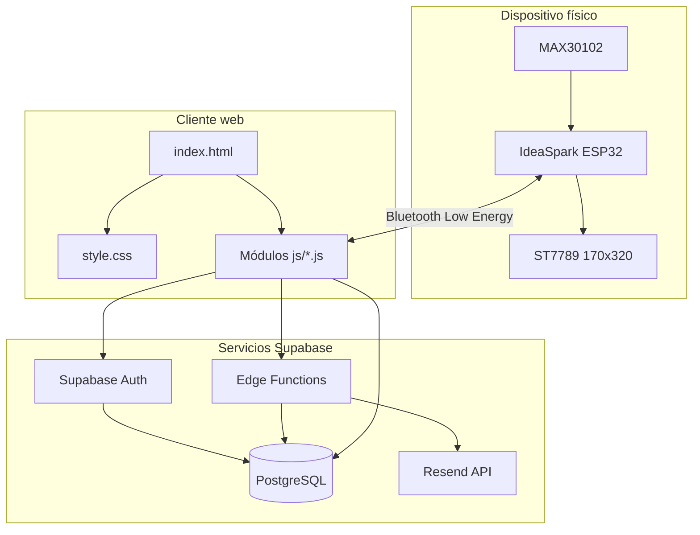

# 02 — Arquitectura y estructura del repositorio

## 1. Vista por capas



### Responsabilidades

- **Hardware:** obtiene señal óptica y presenta estados locales.
- **Firmware:** estima el pulso, valida intervalos, genera mensajes y publica una característica BLE.
- **Navegador:** administra la sesión, solicita permisos, recibe BLE, dibuja la interfaz y llama a Supabase.
- **Supabase Auth:** identifica al usuario.
- **PostgreSQL:** conserva perfiles, dispositivos, contactos, lecturas, ubicaciones y alertas según el esquema desplegado.
- **Edge Functions:** ejecutan lógica del servidor que no debe exponerse al navegador.
- **Resend:** proveedor externo de envío de correo.

## 2. Árbol principal

```text
Aplicacion_AMAR/
├── index.html                         # Vistas, panel, formularios y contenedores
├── style.css                          # Sistema visual responsive y paleta
├── supabase-config.js                 # URL y clave pública de Supabase
├── app.js                             # Inicialización/orquestación del cliente
├── Completop.ino                      # Firmware del dispositivo
├── README.md                          # Entrada a toda la documentación
├── README-PALETA.md                   # Referencia rápida de colores
├── js/
│   ├── auth.js                        # Inicio y cierre de sesión
│   ├── core.js                        # Utilidades compartidas, vistas y modales
│   ├── dashboard.js                   # Carga de datos del panel
│   ├── bluetooth.js                   # Conexión BLE y recepción de lecturas
│   ├── devices.js                     # CRUD de dispositivos
│   ├── contacts.js                    # CRUD de contactos de emergencia
│   ├── history.js                     # Calendario, resúmenes e historial
│   ├── profile.js                     # Edición de perfil
│   └── alerts.js                      # SOS, alertas, ubicación y comunicaciones
├── supabase/
│   ├── config.toml                    # Configuración local de Supabase CLI
│   └── functions/
│       ├── amar-email/index.ts        # Aviso por correo a un contacto elegido
│       └── amar-sos/index.ts          # Registra SOS y notifica contactos por correo
└── docs/
    ├── 01-PROYECTO-Y-ALCANCE.md
    ├── 02-ARQUITECTURA.md
    ├── 03-APLICACION-WEB.md
    ├── 04-HARDWARE-Y-FIRMWARE.md
    ├── 05-BACKEND-DATOS-Y-SEGURIDAD.md
    ├── 06-DISENO-Y-PALETA.md
    └── 07-PRUEBAS-LIMITES-Y-CRONOLOGIA.md
```

El árbol describe las rutas principales; pueden existir archivos auxiliares adicionales. Los archivos de migración SQL no se presuponen: las tablas y políticas deben comprobarse en el proyecto Supabase real.

## 3. Módulos y dependencias

| Módulo | Lee/recibe | Produce/actualiza |
|---|---|---|
| `core.js` | Eventos y selectores DOM | Vistas, mensajes, modales y utilidades comunes |
| `auth.js` | Formularios de autenticación | Sesión de Supabase |
| `dashboard.js` | Usuario y consultas a tablas | Indicadores y tarjetas del panel |
| `bluetooth.js` | Servicio BLE y notificaciones | Lectura actual, persistencia y estado de conexión |
| `devices.js` | Formularios y usuario autenticado | Registros de dispositivos |
| `contacts.js` | Formularios y usuario autenticado | Contactos de emergencia |
| `history.js` | Filas de lecturas | Calendario y resúmenes por período |
| `profile.js` | Datos del perfil | Actualización del perfil |
| `alerts.js` | Eventos SOS, lectura y ubicación | Registro de alertas y llamadas a Edge Functions |

## 4. Flujo de lectura

1. El sensor MAX30102 genera muestras ópticas.
2. El firmware comprueba el sensor, detecta latidos y calcula LPM según sus reglas.
3. La placa publica un mensaje en BLE.
4. El navegador recibe la notificación y valida el contenido.
5. El módulo Bluetooth actualiza la lectura y trata de guardarla en la base.
6. El panel y el historial presentan los registros persistidos.

Si BLE se desconecta, el navegador no puede recibir lecturas nuevas hasta reconectar. El último valor visible no debe interpretarse como actual si su marca temporal no es reciente.

## 5. Flujo de SOS

1. El usuario confirma la solicitud SOS manual o se activa el flujo automático implementado.
2. La web obtiene el usuario autenticado y solicita ubicación de forma opcional.
3. `amar-sos` valida la sesión y registra la alerta en `alerts`.
4. La función consulta contactos asociados al usuario.
5. Si hay correo configurado y destinatarios con correo, intenta enviar un mensaje por Resend a cada uno.
6. La respuesta informa contadores de envío/fallo.
7. La interfaz distingue el registro de la alerta del estado de las comunicaciones.

## 6. Decisiones de arquitectura

- La aplicación es una web de una sola página (SPA) con vistas alternadas, no una aplicación React Native.
- HTML/CSS/JavaScript mantienen la interfaz ejecutable en un navegador.
- BLE conecta el dispositivo y un navegador compatible; el acceso depende del navegador, permisos y contexto seguro.
- Supabase aporta autenticación y PostgreSQL.
- Las claves privadas de correo se guardan como secretos del servidor.

## 7. Límites de confianza

El navegador y sus entradas no se consideran confiables. Las Edge Functions deben validar autenticación, campos y propiedad de registros; PostgreSQL debe aplicar RLS. La validación en JavaScript mejora la experiencia, pero no reemplaza las políticas del servidor.
