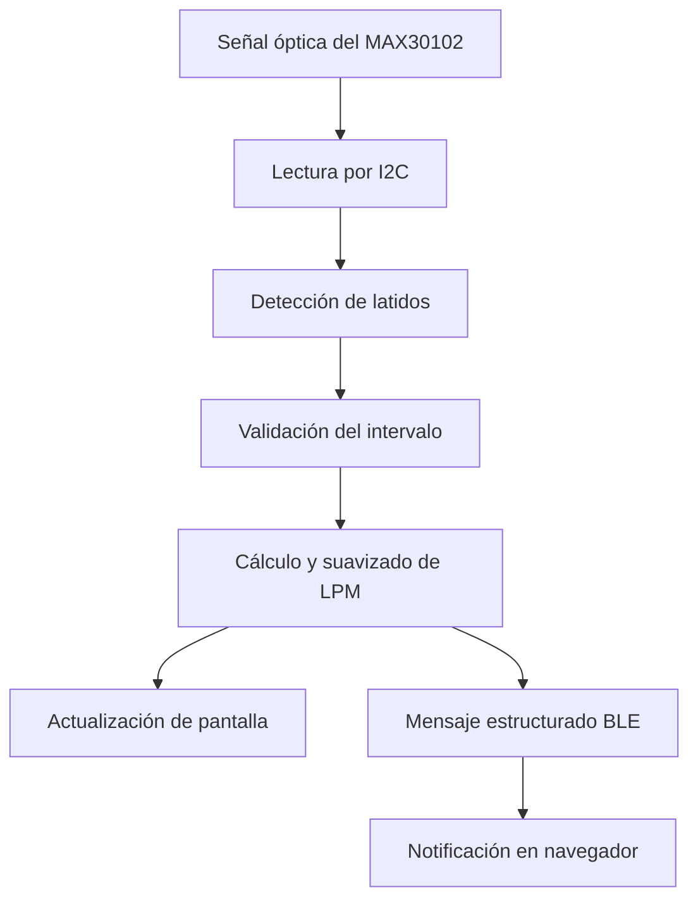

# 04 — Hardware y firmware

## 1. Componentes confirmados en el firmware

| Componente | Función |
|---|---|
| Placa IdeaSpark ESP32 | Microcontrolador, lectura de sensor, pantalla y BLE. |
| MAX30102 | Sensor óptico empleado para obtener señal relacionada con el pulso. |
| Pantalla ST7789 de 170 × 320 px | Interfaz local del dispositivo. |
| Bus I²C | Comunicación con el sensor. |
| Bus SPI | Comunicación con la pantalla. |
| Bluetooth Low Energy | Transporte de lecturas y estado hacia la web. |
| Arduino/C++ | Lenguaje y entorno del firmware en `Completop.ino`. |

El firmware del repositorio declara la versión **v4.1** en `FW_VERSION`. Confirmar la versión instalada en la placa antes de asumir que coincide con la versión de GitHub.

## 2. Responsabilidades del firmware

- Inicializar periféricos y bibliotecas.
- Comprobar el estado del MAX30102.
- Recuperarse de ciertos fallos de I²C según la lógica implementada.
- Detectar eventos de latido y calcular una estimación de LPM.
- Rechazar intervalos fuera de los límites configurados.
- Suavizar/combinar muestras según el algoritmo implementado.
- Actualizar la pantalla con estado del sensor y lectura.
- Publicar información mediante un servicio/característica BLE.
- Distinguir estado del sensor y validez/antigüedad de la medición.

## 3. Pines y conexiones

La asignación exacta debe contrastarse con el bloque de configuración de `Completop.ino` y con la revisión física de la placa antes de cablear. Los comentarios del código son la referencia primaria, porque el pinout puede cambiar entre revisiones de hardware.

| Señal del firmware v4.1 | GPIO | Propósito |
|---|---:|---|
| I²C SDA | 25 | Datos del MAX30102. |
| I²C SCL | 26 | Reloj del MAX30102. |
| TFT MOSI | 23 | Datos SPI hacia ST7789. |
| TFT SCLK | 18 | Reloj SPI de la pantalla. |
| TFT CS | 15 | Selección de pantalla. |
| TFT DC | 2 | Selección comando/datos. |
| TFT RST | 4 | Reinicio de pantalla. |
| TFT BL | 32 | Control de retroiluminación. |
| MAX30102 I²C address | `0x57` | Dirección declarada para la comprobación del sensor. |

Estos son los GPIO declarados en el firmware `Completop.ino` v4.1 del repositorio. Antes de cablear, verificar la serigrafía, el pinout de la revisión exacta de la placa y los niveles eléctricos admitidos.

## 4. Cadena de medición

La estimación depende del contacto del sensor con la piel, movimiento, iluminación, alimentación, calidad de la señal y parámetros del algoritmo. Un valor numérico no garantiza exactitud clínica.

## 5. Bluetooth Low Energy

El firmware implementa un servidor BLE. La web busca el servicio y característica configurados en ambos extremos y se suscribe a sus notificaciones. Los UUID declarados tanto en `Completop.ino` como en `js/bluetooth.js` son:\n\n| Elemento BLE | UUID |\n|---|---|\n| Servicio | `4fafc201-1fb5-459e-8fcc-c5c9c331914b` |\n| Característica | `beb5483e-36e1-4688-b7f5-ea07361b26a8` |\n\nDeben mantenerse idénticos en ambos extremos. Si se modifica uno, actualizar y probar ambos lados.

El transporte BLE no equivale a conexión a Internet: el navegador recibe los datos directamente desde el dispositivo y después puede guardarlos en Supabase.

## 6. Fecha y hora

El firmware declara que no usa Wi-Fi para sincronizar hora y que la aplicación participa en la sincronización temporal. Verificar el formato y la zona horaria de cada mensaje para evitar desplazar registros al día anterior/siguiente. La base debe almacenar marcas temporales consistentes y la interfaz convertirlas para mostrarlas en hora local.

## 7. Pruebas físicas recomendadas

1. Encender la placa y confirmar que la pantalla inicia.
2. Comprobar que el sensor responde por I²C.
3. Observar el estado sin dedo y confirmar que no se presenta como lectura válida.
4. Colocar el dedo estable y comparar la lectura con un dispositivo de referencia sin asumir que eso constituye validación clínica.
5. Verificar la antigüedad de la lectura y el comportamiento al retirar el dedo.
6. Conectar por BLE, recibir varias notificaciones y revisar que la web actualiza la hora.
7. Desconectar y reconectar el dispositivo.
8. Confirmar que el historial no duplica lecturas por una suscripción repetida.
9. Revisar el funcionamiento de pantalla y sensor después de un fallo I²C.
10. Probar con movimientos moderados y documentar límites de la señal.

## 8. Seguridad y limitaciones

No usar el prototipo para decidir tratamientos, suspender medicación o descartar síntomas. Si una persona presenta síntomas importantes, debe buscar asistencia médica sin esperar a que A.M.A.R. responda. El firmware y la interfaz no son un dispositivo médico certificado.

## Actualización de fuente de verdad del firmware

El firmware vigente se mantiene en el repositorio separado [Tomicasgit/ESP32_Proyecto2030](https://github.com/Tomicasgit/ESP32_Proyecto2030), archivo [`Completop.ino`](https://github.com/Tomicasgit/ESP32_Proyecto2030/blob/main/Completop.ino), versión declarada v5.3. La copia `Completop.ino` de este repositorio web declara v4.1 y es histórica.

La placa de referencia actual es la IdeaSpark ESP32 con ST7789 integrada de 170 × 320 y sensor externo MAX30102. El firmware v5.3 usa I²C SDA 25/SCL 26 a 100 kHz; pantalla SPI MOSI 23, SCLK 18, CS 15, DC 2, RST 4 y BL 32. No usa Wi-Fi: la web sincroniza fecha/hora por BLE.

Consultar [24 — Referencia completa del firmware v5.3](24-REFERENCIA-FIRMWARE-V5.3.md) para algoritmo, estados, parámetros y telemetría; consultar el plan de pruebas incluido en [24 — Referencia completa del firmware v5.3](24-REFERENCIA-FIRMWARE-V5.3.md) antes de considerar validado el hardware.
