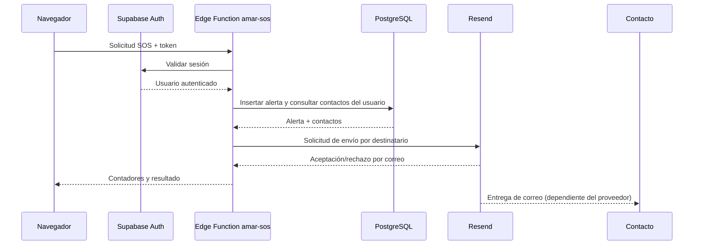

# 05 — Backend, datos, correo y seguridad

## 1. Supabase

A.M.A.R. utiliza Supabase para autenticación y persistencia. La aplicación referencia una instancia configurada en `supabase-config.js`; la URL y la clave pública del cliente no son secretos administrativos. El proyecto real debe aplicar políticas de seguridad de filas (RLS) y permisos mínimos.

## 2. Tablas que utiliza el código

El siguiente mapa se deriva de las consultas presentes en el cliente y las funciones. Los tipos exactos, claves foráneas, índices y políticas deben verificarse en el esquema desplegado de Supabase; este repositorio no debe considerarse un sustituto de las migraciones reales.

| Tabla | Uso observado |
|---|---|
| `profiles` | Datos del perfil; la función SOS consulta `name` por el ID del usuario. |
| `devices` | Dispositivos asociados al usuario y metadatos de vinculación. |
| `emergency_contacts` | Nombre, teléfono, correo y relación/contacto de emergencia. |
| `heart_readings` | Mediciones de LPM asociadas al usuario/dispositivo y su tiempo. |
| `locations` | Ubicaciones guardadas con marca temporal y coordenadas. |
| `alerts` | Registro de solicitudes manuales/automáticas, mensaje, estado y propietario. |

No asumir que esta lista es un DDL completo. Antes de modificar la base, inspeccionar las tablas, restricciones y políticas reales del proyecto Supabase.

## 3. Función `amar-sos`

Archivo: `supabase/functions/amar-sos/index.ts`.

1. Atiende solicitudes HTTP y preflight CORS.
2. Exige un encabezado Bearer.
3. Valida el token de Supabase Auth.
4. Acepta tipos de alerta definidos (manual y automática).
5. Normaliza el mensaje y valida coordenadas opcionales.
6. Inserta la alerta en `alerts`.
7. Consulta contactos pertenecientes al usuario autenticado.
8. Lee `RESEND_API_KEY` y `RESEND_FROM_EMAIL` del entorno del servidor.
9. Si hay configuración y destinatarios, intenta enviar un correo individual a cada contacto mediante Resend.
10. Devuelve contadores `email_contacts_count`, `email_sent_count`, `email_failed_count`, el estado de configuración y la alerta registrada.

**Interpretación del resultado:** `email_sent_count > 0` significa que la API de Resend aceptó uno o más envíos; no demuestra por sí solo que el mensaje llegó a la bandeja de entrada o fue leído. Si `email_failed_count > 0` y también hubo envíos, el resultado es parcial y la interfaz debe mostrar ambos contadores, no un fallo total.

## 4. Función `amar-email`

Archivo: `supabase/functions/amar-email/index.ts`.

- Valida el método, CORS y sesión.
- Obtiene el contacto por ID y limita la consulta al usuario autenticado.
- Lee los datos de perfil necesarios para personalizar el aviso.
- Requiere los secretos de Resend.
- Construye una plantilla de emergencia predefinida, con ubicación opcional.
- Envía el mensaje por la API de Resend y devuelve una respuesta estructurada.

La interfaz de contactos del modal SOS ya no muestra un botón de correo por contacto: el correo forma parte del flujo SOS y no debe confundirse con un enlace local. La función puede seguir siendo útil para un flujo específico de envío directo si se expone deliberadamente en la interfaz en el futuro.

## 5. Plantilla de aviso

El mensaje informa que se registró una alerta A.M.A.R., el nombre/cuenta disponible, el tipo de alerta, el detalle, la ubicación si está disponible, la fecha y una advertencia de que el aviso no confirma atención médica.

El correo no debe incluir más información personal de la necesaria. No registrar claves, tokens, mensajes privados ni coordenadas en logs públicos.

## 6. Secretos y despliegue

Los secretos requeridos para correo son:

- `RESEND_API_KEY`: clave privada de Resend.
- `RESEND_FROM_EMAIL`: remitente autorizado/verificado en Resend.

Configuración desde un entorno donde Supabase CLI esté instalado y vinculado al proyecto correcto:

```bash
supabase secrets set RESEND_API_KEY=tu_clave_resend RESEND_FROM_EMAIL="A.M.A.R. <alertas@tu-dominio.com>"
supabase functions deploy amar-sos
supabase functions deploy amar-email
```

Usar un dominio remitente verificado en Resend. No pegar la clave en el frontend, el repositorio, capturas o documentación. Los destinatarios permitidos durante el modo de prueba pueden estar restringidos por el proveedor.

## 7. Modelo de confianza



## 8. RLS y autorización

En el proyecto Supabase, comprobar que:
- Cada usuario solo lea y modifique su propio perfil.
- Los contactos y dispositivos se filtren por el propietario.
- Las lecturas, ubicaciones y alertas se asocien al usuario correcto.
- No existan políticas abiertas de escritura/lectura sobre datos sensibles.
- Las funciones comprueben identidad y propiedad, no confíen en un `user_id` enviado por el cliente.
- Las claves de servicio y de Resend no se entreguen al navegador.

## 9. Qué significa “enviado”

| Estado | Significado |
|---|---|
| Alerta registrada | La fila de alerta se guardó en la base de datos. |
| Resend aceptó el envío | El proveedor aceptó la solicitud de correo; aún puede existir procesamiento posterior. |
| Entregado | El proveedor reporta entrega, si ese dato se integra y consulta. |
| Leído/respondido | No se deduce del envío; requiere acción del destinatario. |

## 10. Errores frecuentes

- Sin `RESEND_API_KEY` o `RESEND_FROM_EMAIL`: el SOS puede registrarse, pero el correo no se intenta enviar.
- Sin contactos con correo: se registra la alerta, pero no hay destinatarios.
- Error parcial: algunos correos pueden enviarse y otros fallar.
- Dominio remitente no verificado o destinatario de prueba no autorizado: Resend puede rechazar el envío.
- Sesión expirada: la función devuelve un error de autenticación.
- El navegador puede mostrar un error de red aunque el proveedor haya procesado una solicitud; revisar la respuesta del servidor y el panel del proveedor antes de concluir que el mensaje no salió.

## 11. Privacidad de ubicación

La ubicación es opcional. La denegación de permisos no debería bloquear el registro de una alerta. Si se añade una coordenada al correo, se convierte en información sensible: compartirla solo con los destinatarios autorizados y evitar conservarla más tiempo del necesario.
