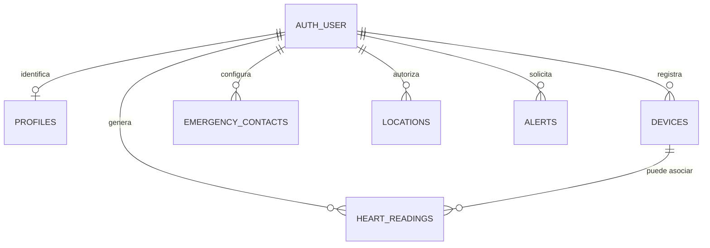

# 08 — Diccionario de datos y modelo conceptual

> **Estado de precisión:** este documento registra las tablas y campos que el código consultado utiliza. No sustituye al esquema SQL real de Supabase. Los tipos, restricciones, índices, relaciones y políticas definitivas deben exportarse desde el proyecto Supabase desplegado y mantenerse aquí sincronizados.

## 1. Entidades

Las relaciones del diagrama son conceptuales. La existencia de claves foráneas y sus reglas de borrado debe confirmarse en la base de datos.

## 2. `profiles`

| Campo observado | Uso | Nota |
|---|---|---|
| `id` | Identificar al usuario del perfil | Debe corresponder a la identidad autenticada según el diseño de Supabase. |
| `name` | Nombre visible y personalización de avisos | No debe usarse para autorización. |

El módulo `js/profile.js` administra la edición de perfil. El dashboard y la función SOS consultan el nombre disponible.

## 3. `devices`

| Campo observado | Uso |
|---|---|
| `id` | Identificador del dispositivo registrado. |
| `user_id` | Propietario al que se asocia. |
| `name` | Nombre descriptivo mostrado al usuario. |
| `status` | Estado visible del dispositivo. |
| `last_seen_at` | Marca temporal de la última actividad conocida. |
| `created_at` | Orden de creación en el listado. |

El CRUD de dispositivos se encuentra en `js/devices.js`; la lógica BLE también consulta/actualiza el registro de dispositivo. No confundir el registro de la base con la conexión Bluetooth en tiempo real.

## 4. `emergency_contacts`

| Campo observado | Uso |
|---|---|
| `id` | Identificador del contacto. |
| `user_id` | Propietario del registro. |
| `name` | Nombre de la persona de confianza. |
| `phone` | Número usado por el enlace `tel:`. |
| `email` | Destino posible de las notificaciones del servidor. |
| `relationship` | Relación descriptiva (por ejemplo, familiar). |
| `created_at` | Orden de listado. |

El botón “Correo” fue retirado de la vista “Mis contactos de emergencia”, porque el enlace `mailto:` dependía de una aplicación de correo local y no enviaba el aviso mediante el servidor. El correo se conserva como dato del contacto para el flujo SOS del backend.

## 5. `heart_readings`

| Campo/atributo usado | Uso | Precaución |
|---|---|---|
| `user_id` | Relacionar lecturas con el usuario | Debe comprobarse mediante autorización. |
| `device_id` | Dispositivo que produjo la lectura cuando se dispone del dato | Puede no estar presente en todos los registros históricos. |
| Valor de LPM | Lectura que muestra panel/historial | No es diagnóstico médico. |
| Marca temporal | Orden y agrupación por día/semana/mes | Confirmar formato y zona horaria. |

El módulo `js/bluetooth.js` guarda lecturas con limitación temporal para evitar insertar cada notificación BLE sin pausa. `js/history.js` consulta y agrupa los datos. Los nombres exactos de columnas de valor/tiempo deben confirmarse en el esquema desplegado antes de migrar.

## 6. `locations`

El flujo SOS puede guardar coordenadas y una marca temporal, con permiso del usuario. La ubicación no debe tratarse como disponible si el navegador no la obtuvo. Las coordenadas permiten construir un enlace de mapa; son información sensible.

## 7. `alerts`

| Campo conceptual/observado | Propósito |
|---|---|
| Identificador | Referencia de la alerta creada. |
| Propietario | Usuario que originó el evento. |
| Tipo | Diferenciar SOS manual y alerta automática. |
| Mensaje/detalle | Contexto del evento. |
| Marca temporal | Auditoría básica del evento. |

La estructura exacta de las columnas de `alerts` debe verificarse en el código de la Edge Function y el esquema desplegado. El registro de una alerta y el envío de correo son operaciones distintas.

## 8. Identificadores, tiempos y datos opcionales

- Usar identificadores estables, no nombres como clave.
- Guardar tiempos en una representación consistente; presentar en la zona horaria local.
- Diferenciar valor ausente de cero: una lectura desconocida no es 0 LPM.
- Distinguir contacto sin correo, correo no configurado y correo rechazado.
- La ubicación puede ser nula si se deniega el permiso.
- No almacenar duplicados por reconexión BLE o por suscripciones repetidas.

## 9. Consultas observadas en el código

| Archivo | Tablas consultadas |
|---|---|
| `js/dashboard.js` | `profiles`, `heart_readings`, `devices`, `emergency_contacts`, `alerts`, `locations` |
| `js/bluetooth.js` | `heart_readings`, `devices` |
| `js/history.js` | `heart_readings` |
| `js/contacts.js` | `emergency_contacts` |
| `js/devices.js` | `devices` |
| `js/profile.js` | `profiles` |
| `js/alerts.js` | `alerts`, `locations`, `emergency_contacts` |
| `amar-sos` | `alerts`, `emergency_contacts`, `profiles` |
| `amar-email` | `emergency_contacts`, `profiles` |

## 10. Pendientes para cerrar el esquema documental

- [ ] Exportar el DDL real de Supabase.
- [ ] Documentar tipos y nulabilidad de cada columna.
- [ ] Registrar claves primarias y foráneas.
- [ ] Registrar índices y restricciones únicas.
- [ ] Copiar el contenido de las políticas RLS, sin secretos.
- [ ] Añadir política de retención/borrado de datos.
- [ ] Probar las reglas con dos cuentas de prueba distintas.
