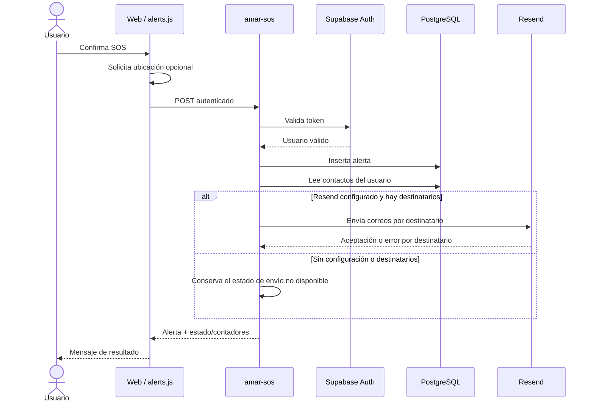

# 10 — Contratos, flujos y respuestas de API

## 1. Modelo de comunicación

A.M.A.R. no tiene una única API propia para todas las operaciones: el cliente usa el SDK de Supabase para Auth y consultas de datos, y usa Edge Functions para flujos que necesitan lógica de servidor, como el SOS y el envío predefinido de correo.

| Canal | Origen → destino | Uso |
|---|---|---|
| GATT / BLE | ESP32 → navegador | Lectura actual y estado del dispositivo. |
| Supabase Auth | Navegador ↔ Supabase | Crear sesión, iniciar y cerrar sesión, consultar identidad. |
| Supabase Data API | Navegador ↔ PostgreSQL | CRUD de datos protegidos por políticas. |
| Edge Function `amar-sos` | Navegador → servidor | Registrar SOS y coordinar notificaciones. |
| Edge Function `amar-email` | Navegador → servidor | Envío predefinido a un contacto específico cuando se invoca. |
| Resend | Edge Function → proveedor | Solicitud de envío de correo. |

## 2. Requisitos comunes de Edge Functions

- Método HTTP y encabezados permitidos deben coincidir con CORS.
- Las solicitudes autenticadas incluyen `Authorization: Bearer <access_token>`.
- La función valida el token con Supabase Auth.
- Los datos de entrada se validan en servidor; no confiar en validación exclusiva del cliente.
- Los errores deben devolver un estado HTTP apropiado y un objeto JSON entendible.
- Los secretos permanecen en el entorno de Supabase.
- No incluir tokens, coordenadas completas ni direcciones personales en logs de diagnóstico compartidos.

## 3. Flujo de SOS manual



## 4. Estados del envío

La respuesta puede representar varios resultados independientes. La interfaz no debe reducirlos todos a “éxito” o “fallo” sin analizar los campos devueltos.

| Resultado | Interpretación | Mensaje de interfaz recomendado |
|---|---|---|
| Alerta insertada | El evento quedó registrado. | “La solicitud quedó registrada”. |
| Uno o más envíos aceptados, cero fallos | Resend aceptó todos los intentos reportados como enviados. | “El servicio confirmó el envío a N contacto(s)”. |
| Envíos y fallos | Resultado parcial. | “Se confirmó el envío a N; M no pudieron enviarse”. |
| Sin configuración | No se intentó enviar por falta de secretos/configuración. | “La alerta quedó registrada; falta configurar el correo”. |
| Sin contactos con email | No existen destinatarios elegibles. | “La alerta quedó registrada; no hay contactos con correo”. |
| Todos los intentos fallaron | No hay envío aceptado. | “La alerta quedó registrada, pero el proveedor no pudo enviar los correos”. |
| Respuesta ambigua | No puede confirmarse el estado. | “La alerta quedó registrada; no se pudo confirmar el envío”. |

“Resend aceptó el envío” no equivale a “el correo llegó” ni “fue leído”. La entrega final depende del proveedor, del dominio, de filtros antispam y del servidor destinatario.

## 5. Contrato BLE

El cliente y el firmware deben usar los mismos UUID:
- Servicio: `4fafc201-1fb5-459e-8fcc-c5c9c331914b`
- Característica: `beb5483e-36e1-4688-b7f5-ea07361b26a8`

El formato exacto del mensaje debe mantenerse sincronizado con el analizador en `js/bluetooth.js`. Al cambiarlo, documentar un ejemplo válido, los campos obligatorios, unidades, codificación y comportamiento cuando un campo falta. No interpretar una carga malformada como cero LPM.

## 6. Flujo de persistencia de lecturas

1. La característica BLE emite una notificación.
2. El cliente decodifica el mensaje.
3. Comprueba que contiene un valor interpretable y estado/tiempo consistentes.
4. Actualiza el indicador visual.
5. Si corresponde según el intervalo mínimo, inserta el registro en `heart_readings`.
6. El historial consulta las filas guardadas.

El indicador en pantalla y la persistencia son dos resultados distintos: una lectura puede verse en vivo y no haberse guardado por un fallo de red.

## 7. Reintentos e idempotencia

Un SOS repetido puede generar más de una alerta si no se aplica una clave de idempotencia. Antes de añadir reintentos automáticos, decidir cómo evitar correos duplicados y cómo representar los reintentos. Para BLE, asegurar que una reconexión quite el listener anterior antes de añadir otro.

## 8. Códigos de error que deben contemplarse

- Sesión ausente/expirada.
- Token no válido.
- Método HTTP no permitido.
- JSON malformado.
- Contacto no encontrado o que pertenece a otro usuario.
- Datos de coordenadas fuera de rango.
- Error de inserción/consulta.
- Secretos ausentes.
- Resend rechaza remitente/destinatario.
- Error de red o timeout.
- Respuesta no JSON o incompatible con la versión de la interfaz.

## 9. Verificación del contrato real

Este documento resume el contrato de la implementación existente. Para una especificación definitiva, extraer los campos de entrada y respuesta exactos de cada función en su código actual y mantener un ejemplo de request/response sanitizado en el repositorio. Nunca usar tokens reales en los ejemplos.


## 10. Contrato actual del firmware canónico v5.3

El firmware vigente se mantiene en [Tomicasgit/ESP32_Proyecto2030](https://github.com/Tomicasgit/ESP32_Proyecto2030), archivo [`Completop.ino`](https://github.com/Tomicasgit/ESP32_Proyecto2030/blob/main/Completop.ino). La copia `Completop.ino` de este repositorio web declara v4.1 y es histórica. Consultar [24 — Referencia completa del firmware v5.3](24-REFERENCIA-FIRMWARE-V5.3.md).

### BLE GATT

- Nombre anunciado: `A.M.A.R`.
- Servicio: `4fafc201-1fb5-459e-8fcc-c5c9c331914b`.
- Característica: `beb5483e-36e1-4688-b7f5-ea07361b26a8`.
- Propiedades: READ, NOTIFY y WRITE.
- Intervalo de actualización configurado: 800 ms.
- WRITE se utiliza para recibir timestamp ISO 8601 desde la web.

### Telemetría JSON

```json
{
  "timestamp": "2026-10-11T09:25:30-03:00",
  "lpm": 68,
  "average": 66,
  "sensor_state": "midiendo",
  "user_state": "normal",
  "quality": 4,
  "alert": false
}
```

Los valores son ilustrativos, no una medición real.

- `timestamp`: ISO 8601 o `null` antes de sincronizar el reloj.
- `lpm`: entero redondeado; 0 significa que no hay medición vigente.
- `average`: promedio reciente; 0 si no hay medición vigente.
- `sensor_state`: `error_sensor`, `sin_contacto`, `estabilizando`, `sin_datos` o `midiendo`.
- `user_state`: `sin_datos`, `normal`, `precaucion` o `critico`.
- `quality`: indicador heurístico 0–5, no un porcentaje ni una garantía de precisión.
- `alert`: booleano que representa alerta crítica confirmada, no el envío de un SOS.

El firmware actualiza el valor READ aunque no haya cliente y usa NOTIFY cuando detecta conexión. Por eso la aplicación debe gestionar tanto la lectura inicial como las notificaciones. Una conexión BLE no prueba que se recibió un JSON válido ni que una fila se guardó en Supabase.
