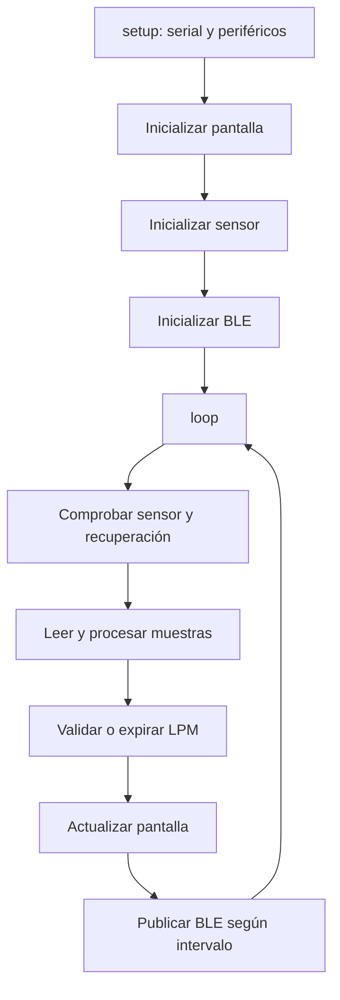

# 17 — Referencia de implementación del firmware

**Archivo principal:** `Completop.ino`  
**Versión declarada:** `v4.1`  
**Objetivo:** documentar las constantes y funciones de mayor importancia del sketch, para que cada modificación pueda entenderse y probarse.

## 1. Bibliotecas

El sketch incluye Arduino, Wire, SPI, funciones de tiempo y manejo de cadenas; bibliotecas Adafruit GFX/ST7789 para pantalla; bibliotecas del MAX3010x para el sensor; y BLE de ESP32. Las versiones exactas instaladas deben anotarse al compilar, porque una actualización de biblioteca puede cambiar compatibilidad o comportamiento.

## 2. Constantes principales declaradas

| Constante | Valor en el archivo | Uso |
|---|---:|---|
| `FW_VERSION` | `v4.1` | Versión declarada por el firmware. |
| `I2C_SDA` | GPIO 25 | Datos del bus I²C. |
| `I2C_SCL` | GPIO 26 | Reloj del bus I²C. |
| `TFT_MOSI` | GPIO 23 | Datos SPI de pantalla. |
| `TFT_SCLK` | GPIO 18 | Reloj SPI de pantalla. |
| `TFT_CS` | GPIO 15 | Selección de pantalla. |
| `TFT_DC` | GPIO 2 | Comando/datos. |
| `TFT_RST` | GPIO 4 | Reinicio de pantalla. |
| `TFT_BL` | GPIO 32 | Retroiluminación. |
| `I2C_ADDRESS` | `0x57` | Dirección esperada del MAX30102. |
| `UMBRAL_DEDO` | `90000` | Umbral de señal para detectar presencia del dedo. |
| `VELOCIDAD_I2C` | `400000` | Velocidad configurada del bus I²C. |
| `MAX_FALLOS_I2C` | `3` | Umbral de fallos consecutivos antes de la recuperación. |
| `NUM_MUESTRAS_PROMEDIO` | `4` | Cantidad de valores en el promedio móvil. |
| `FRECUENCIA_MUESTREO` | `100` | Parámetro de muestreo del sensor configurado. |
| `ESTABILIZACION_MS` | `2000` | Ventana de estabilización declarada. |
| `LATIDO_MIN_MS` | `300` | Intervalo mínimo admitido entre latidos. |
| `LATIDO_MAX_MS` | `2000` | Intervalo máximo admitido entre latidos. |
| `EXPIRACION_LPM_MS` | `5000` | Tiempo para invalidar una lectura envejecida. |
| `CHEQUEO_MS` | `2000` | Período de comprobación del sensor. |
| `REINTENTO_MS` | `5000` | Espera declarada entre intentos de recuperación. |
| `INTERVALO_TX_MS` | `1000` | Intervalo mínimo de transmisión BLE. |
| `BUFFER_JSON` | `256` | Tamaño del buffer usado para el mensaje JSON. |
| `ZONA_HORARIA_SEGUNDOS` | `-10800` | Diferencia horaria configurada para Argentina (UTC−3). |
| `LPM_PRECAUCION_BAJO` | `50` | Umbral interno visual/de estado, no diagnóstico. |
| `LPM_PRECAUCION_ALTO` | `120` | Umbral interno visual/de estado, no diagnóstico. |
| `LPM_CRITICO_BAJO` | `40` | Umbral interno crítico del prototipo. |
| `LPM_CRITICO_ALTO` | `150` | Umbral interno crítico del prototipo. |

**Advertencia:** son parámetros de implementación. No deben interpretarse como umbrales médicos personalizados ni recomendaciones clínicas. El algoritmo puede fallar por movimiento, contacto, perfusión, luz y otras condiciones.

## 3. Funciones principales

| Función | Responsabilidad |
|---|---|
| `dibujarPantallaBase()` | Dibuja la estructura visual inicial. |
| `iniciarPantalla()` | Inicializa el controlador y la pantalla. |
| `escribirCampo(...)` | Escribe una zona de texto de la pantalla. |
| `actualizarPantalla()` | Actualiza lectura, estado y elementos visuales. |
| `calcularCalidad()` | Produce un indicador de calidad según las reglas del sketch. |
| `obtenerTimestampISO8601(...)` | Forma una marca temporal en formato ISO 8601 cuando puede hacerlo. |
| `establecerTimestamp(...)` | Procesa una marca temporal recibida desde el cliente. |
| `inicializarSensor()` | Prepara y comprueba el MAX30102. |
| `configurarSensor()` | Configura parámetros de adquisición del sensor. |
| `procesarSensor()` | Procesa muestras, detecta latidos y actualiza LPM. |
| `controlarExpiracionLPM()` | Invalida la lectura si excede el tiempo admitido. |
| `chequearSaludSensor()` | Comprueba respuesta del sensor y activa recuperación según reglas. |
| `invalidarMedicion()` | Marca la medición como no válida. |
| `limpiarHistorial()` | Reinicia la colección de muestras del promedio. |
| `agregarMedicion(...)` | Añade un valor válido a la colección de promedio. |
| `obtenerEstadoSensor()` | Devuelve estado técnico del sensor. |
| `obtenerEstadoUsuario()` | Devuelve estado comprensible para mostrar al usuario. |
| `hayMedicionValida()` | Determina si hay una medición vigente. |
| `hayAlertaCritica()` | Determina si se activa el estado crítico interno. |
| `inicializarBLE()` | Crea servidor, servicio, característica y publicidad BLE. |
| `enviarDatosBLE()` | Construye y publica la carga de datos. |
| `setup()` | Inicialización ejecutada una vez al arrancar. |
| `loop()` | Ciclo de control repetitivo. |

## 4. Estimación de LPM

El sketch calcula el intervalo entre eventos de latido detectados. La fórmula básica usada en el código es:

```text
LPM = 60 000 / intervalo_en_milisegundos
```

Solo se aceptan intervalos dentro de los límites configurados. Los valores válidos se combinan mediante un promedio móvil. Esta lógica reduce algunas fluctuaciones, pero no elimina artefactos ni constituye un algoritmo clínicamente validado.

## 5. Estados del dispositivo

El firmware separa el estado del sensor de la validez de la medición y del estado que se muestra al usuario. Esta separación evita que “sensor detectado” se confunda con “lectura válida”. La interfaz debe conservar esta distinción al interpretar el JSON.

## 6. Recuperación I²C

La función de salud del sensor comprueba periódicamente si el dispositivo responde en su dirección. Tras el número de fallos consecutivos configurado, el sketch entra en una ruta de recuperación/reintento. Los tiempos exactos y las acciones deben volver a verificarse en el cuerpo actual de `chequearSaludSensor()` cuando se cambie el algoritmo.

## 7. Pantalla ST7789

El código separa el dibujo base de la actualización dinámica. La función `escribirCampo` permite actualizar zonas de texto en vez de reconstruir toda la pantalla en cada iteración. Al modificar la UI, comprobar que no haya parpadeo, restos de texto anterior ni regiones sin limpiar.

## 8. Mensaje BLE

La función `enviarDatosBLE()` construye el mensaje JSON y publica datos a intervalos configurados. El cliente espera el servicio y característica documentados en el archivo de arquitectura. Antes de cambiar el JSON, guardar un ejemplo real sanitizado y actualizar el analizador de `js/bluetooth.js`.

## 9. Ciclo de ejecución



El diagrama resume las responsabilidades, no garantiza el orden exacto de cada instrucción del código. Para un cambio de secuencia, consultar el `setup()` y el `loop()` del sketch.

## 10. Procedimiento para cambiar parámetros

1. Identificar la constante y sus usos.
2. Explicar la razón del cambio.
3. Cambiar solo lo necesario.
4. Compilar para la placa exacta.
5. Probar sensor ausente, señal válida y pérdida de señal.
6. Comprobar que la web interpreta el estado correctamente.
7. Actualizar esta tabla y el registro de cambios.
8. Incrementar la versión de firmware cuando corresponda.
