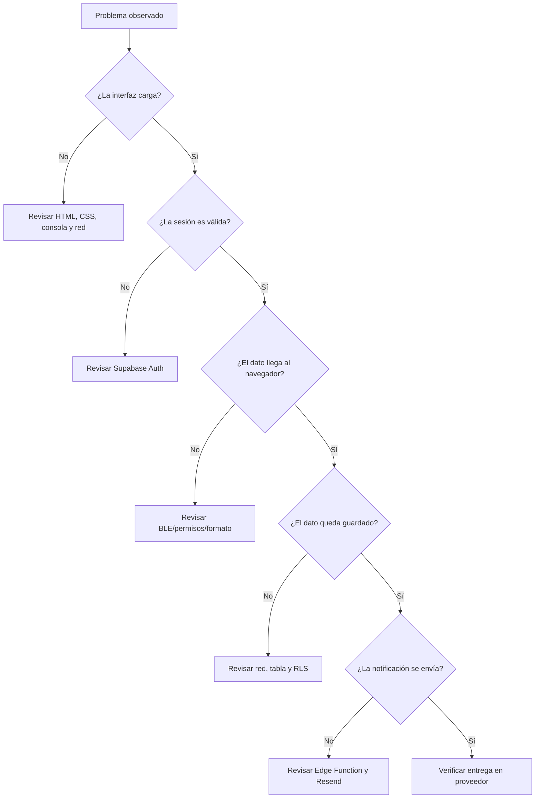

# 19 — Manual de mantenimiento y diagnóstico

## 1. Regla de oro

Antes de cambiar código, identificar qué capa produce el problema. La interfaz, BLE, persistencia y correo son sistemas distintos. Un solo síntoma visible puede tener causas diferentes; comprobar evidencia antes de modificar.

## 2. Diagnóstico por capas

## 3. Diagnóstico de frontend

1. Abrir herramientas de desarrollador del navegador.
2. Revisar errores en Console.
3. Revisar Network para archivos no cargados y respuestas HTTP.
4. Confirmar que `index.html` referencia la versión de CSS/JS esperada.
5. Confirmar que el módulo se carga una sola vez.
6. No compartir capturas que expongan tokens, emails o coordenadas.

## 4. Diagnóstico de BLE

1. Confirmar que la placa arranca y anuncia A.M.A.R.
2. Confirmar que el UUID de servicio coincide en firmware y cliente.
3. Confirmar UUID de característica.
4. Confirmar que se inició la suscripción de notificaciones.
5. Revisar formato de carga y decodificación.
6. Comprobar si la lectura se actualiza antes de investigar la base de datos.
7. Reconectar y comprobar que no se acumulen listeners.

## 5. Diagnóstico de persistencia

- Confirmar que el usuario está autenticado.
- Confirmar el nombre de tabla/columnas reales.
- Revisar error de Supabase sin mostrar información privada.
- Verificar políticas RLS con una cuenta propietaria.
- Comprobar que el historial consulta la misma tabla donde escribe Bluetooth.
- Comprobar las marcas temporales y la conversión a hora local.

## 6. Diagnóstico de SOS y correo

Separar cinco preguntas:
1. ¿El usuario confirmó el SOS?
2. ¿Se insertó la fila de alerta?
3. ¿La Edge Function validó la sesión y encontró contactos?
4. ¿Resend aceptó el envío?
5. ¿El proveedor reportó entrega?

Cada respuesta necesita evidencia distinta. Un mensaje en la interfaz no sustituye a la revisión de la respuesta HTTP y los eventos del proveedor.

## 7. Publicación de cambios

- Cambiar una responsabilidad por commit cuando sea posible.
- Revisar el diff y evitar secretos en el cambio.
- Actualizar cache busting para CSS/JS si corresponde.
- Ejecutar la prueba de regresión relacionada.
- Publicar el frontend y desplegar funciones cuando se hayan modificado.
- Probar la combinación de versiones del cliente y del servidor.
- Actualizar documentación y fecha/commit.

## 8. Plan de mantenimiento periódico

| Frecuencia | Actividad |
|---|---|
| Cada cambio | Revisión de diff, sintaxis, documentación y prueba relacionada. |
| Antes de una presentación | Conexión BLE, lectura, historial, CRUD y SOS de extremo a extremo. |
| Mensualmente o al cambiar dependencias | Revisar versiones, compatibilidad y avisos de seguridad. |
| Al cambiar el esquema | Actualizar diccionario, políticas, consultas y pruebas. |
| Al cambiar hardware | Actualizar pinout, fotos propias, firmware, bibliotecas y pruebas físicas. |
| Si hay sospecha de filtración | Rotar secretos, revisar logs y limitar acceso. |

## 9. Evidencia reproducible

Cada incidencia debería contener:
- Fecha/hora aproximada y zona horaria.
- Commit o versión de frontend/firmware.
- Navegador, sistema operativo y placa.
- Pasos para reproducir.
- Resultado esperado y resultado real.
- Mensaje de error sanitizado.
- Qué se comprobó y qué sigue sin comprobarse.

No incluir contraseñas, tokens, claves, coordenadas exactas ni información personal real.
