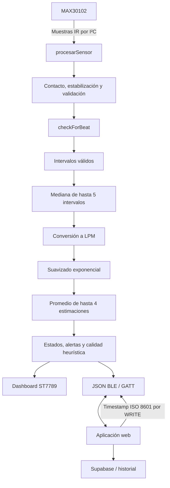

# 24 — Referencia completa del firmware A.M.A.R. v5.3

**Repositorio de código fuente del firmware:** [Tomicasgit/ESP32_Proyecto2030](https://github.com/Tomicasgit/ESP32_Proyecto2030)  
**Archivo fuente principal:** [`Completop.ino`](https://github.com/Tomicasgit/ESP32_Proyecto2030/blob/main/Completop.ino)  
**Versión declarada por el sketch:** `v5.3`  
**Aplicación web:** [Tomicasgit/Aplicacion_AMAR](https://github.com/Tomicasgit/Aplicacion_AMAR)

> Esta referencia describe el firmware v5.3 del repositorio separado. El archivo `Completop.ino` que todavía pueda encontrarse en este repositorio web es una copia histórica v4.1 y no debe tomarse como fuente de verdad para el dispositivo actual.

## 1. Responsabilidad y límites

El firmware se ejecuta en la placa IdeaSpark ESP32 con pantalla ST7789 integrada y sensor óptico MAX30102. Sus tareas son adquirir muestras, estimar LPM, calcular estados orientativos, actualizar la pantalla y exponer los datos mediante Bluetooth Low Energy (BLE).

No utiliza Wi-Fi, no realiza solicitudes HTTP y no accede directamente a Supabase. La web se encarga de mostrar las lecturas, administrar sesión y datos, y guardar las mediciones si la conexión, la autenticación y las políticas de Supabase lo permiten.

A.M.A.R. es un prototipo académico no certificado. No es un ECG, no diagnostica ni descarta enfermedades y no reemplaza la evaluación de un profesional ni los servicios de emergencia.

## 2. Arquitectura



## 3. Bibliotecas utilizadas

- `Arduino.h`: entorno principal, GPIO, temporización y funciones de Arduino.
- `Wire.h`: bus I²C para el sensor.
- `SPI.h`: bus SPI para el TFT.
- `time.h`: conversión de marcas temporales.
- `Adafruit_GFX.h` y `Adafruit_ST7789.h`: dibujo y controlador de pantalla.
- `MAX30105.h` y `heartRate.h`: biblioteca SparkFun MAX3010x y función `checkForBeat()`.
- `BLEDevice.h`, `BLEUtils.h`, `BLEServer.h`, `BLE2902.h`: servidor BLE, servicio GATT, característica y notificaciones.
- `string.h`, `stdio.h`, `ctype.h`, `stdlib.h`: cadenas, formato, validación y utilidades C/C++.

Las versiones exactas del core ESP32 y de las bibliotecas no están fijadas en este repositorio; registrarlas al realizar una compilación reproducible.

## 4. Pines y periféricos

### Sensor MAX30102

| Parámetro | Valor |
|---|---:|
| SDA | GPIO 25 |
| SCL | GPIO 26 |
| Dirección I²C esperada | `0x57` |
| Velocidad I²C | 100000 Hz (100 kHz) |

### Pantalla ST7789 integrada

| Parámetro | Valor |
|---|---:|
| Resolución | 170 × 320 |
| MOSI | GPIO 23 |
| SCLK | GPIO 18 |
| CS | GPIO 15 |
| DC | GPIO 2 |
| RST | GPIO 4 |
| BL / retroiluminación | GPIO 32 |
| Rotación | 0 |
| SPI configurado | 10 MHz |

Confirmar el mapa con la revisión física de la placa antes de cablear. La documentación no reemplaza una inspección del hardware.

## 5. Configuración del sensor en v5.3

| Constante | Valor | Función |
|---|---:|---|
| `UMBRAL_IR_MUNECA_DETECTAR` | 10000 | Umbral de candidato a contacto. |
| `UMBRAL_IR_MUNECA_PERDIDA` | 6000 | Umbral de candidato a pérdida de contacto. |
| `CONFIRMAR_CONTACTO_MS` | 350 ms | Tiempo para confirmar contacto. |
| `CONFIRMAR_PERDIDA_CONTACTO_MS` | 700 ms | Tiempo para confirmar pérdida. |
| `VELOCIDAD_I2C` | 100000 | Velocidad del bus I²C. |
| `MAX_FALLOS_I2C` | 3 | Fallos consecutivos antes de marcar desconexión. |
| `NUM_MUESTRAS_PROMEDIO` | 4 | Capacidad del promedio reciente de LPM. |
| `IR_SATURACION` | 260000 | Las muestras IR iguales o mayores se descartan. |
| `NUM_INTERVALOS_MEDIANA` | 5 | Capacidad de la ventana de intervalos. |
| `FRECUENCIA_MUESTREO` | 100 Hz | Frecuencia configurada. |
| `ESTABILIZACION_MS` | 500 ms | Espera después de confirmar contacto. |
| `LATIDO_MIN_MS` | 300 ms | Intervalo mínimo aceptado. |
| `LATIDO_MAX_MS` | 2000 ms | Intervalo máximo aceptado. |
| `LPM_MIN_VALIDO` | 30 | Límite inferior de plausibilidad configurado. |
| `LPM_MAX_VALIDO` | 200 | Límite superior de plausibilidad configurado. |
| `EXPIRACION_LPM_MS` | 5000 ms | Tiempo máximo sin estimación nueva. |
| `CHEQUEO_MS` | 2000 ms | Período de supervisión I²C. |
| `REINTENTO_MS` | 5000 ms | Espera mínima para reintentar inicialización. |

Los límites son parámetros de programación del prototipo. No son rangos médicos recomendados ni garantías de exactitud.

## 6. Flujo de inicialización

### `setup()`

1. Inicia el monitor serie a 115200 baudios.
2. Imprime versión y descripción de la configuración.
3. establece `TZ=UTC0` para controlar la conversión de tiempo.
4. Inicializa la pantalla mediante `iniciarPantalla()`.
5. Inicializa el MAX30102 mediante `inicializarSensor()`.
6. Inicializa el servidor BLE mediante `inicializarBLE()`.
7. Actualiza la pantalla con los estados iniciales.

Si falla el sensor, el programa marca el error y continúa con pantalla y BLE para que el problema sea visible y el cliente pueda recibir un estado técnico.

### `iniciarPantalla()`

Activa la retroiluminación, configura SPI, inicializa ST7789 a 170 × 320, fija rotación 0 y velocidad de 10 MHz. Muestra una prueba de colores rojo, verde y azul y luego texto de prueba antes de dibujar el dashboard definitivo.

### `inicializarSensor()`

Configura SDA 25/SCL 26, I²C a 100 kHz y llama a `sensor.begin()`. Si el dispositivo no responde, marca el sensor inactivo/desconectado. Si responde, llama a `configurarSensor()`, reinicia el estado de medición y continúa.

### `configurarSensor()`

Configura la adquisición del MAX30102 con los valores indicados en el sketch: LED IR moderado, promediado interno 4, modo 2, frecuencia 100 Hz, ancho de pulso 411 y rango ADC 16384. Ajusta amplitudes roja, IR y verde. Los significados numéricos de los parámetros dependen de la API y versión de la biblioteca instalada.

## 7. Lectura del sensor y contacto

### FIFO de muestras

`procesarSensor()` llama a `sensor.check()`, procesa todas las muestras disponibles con `sensor.available()`, obtiene cada valor mediante `sensor.getIR()` y avanza el FIFO con `sensor.nextSample()`.

### Rechazo de muestras

`procesarMuestraSensor()` descarta valores IR menores o iguales a cero y valores iguales o superiores a 260000. Son considerados vacíos o saturados por la configuración actual. Una muestra inválida aislada no invalida inmediatamente una medición; una pérdida sostenida de señal sí puede hacerlo.

### Histéresis y antirrebote

- Si aún no hay contacto, el IR debe permanecer en o por encima de 10000 durante al menos 350 ms.
- Si ya hay contacto, un IR igual o inferior a 6000 inicia la confirmación de pérdida.
- La pérdida se confirma después de 700 ms.
- Al confirmar contacto, se reinician las ventanas y contadores y se espera 500 ms antes de procesar latidos.

Usar dos umbrales reduce cambios rápidos de estado cuando la señal fluctúa cerca del límite. No garantiza que el sensor esté correctamente colocado ni elimina los artefactos por movimiento, presión, perfusión o luz.

## 8. Algoritmo de estimación de LPM

1. Tras la estabilización, `checkForBeat(valorIR)` identifica eventos de pulso a partir de la señal óptica.
2. Se mide el tiempo entre el evento actual y el anterior con `millis()`.
3. Se rechazan intervalos menores de 300 ms. Si el intervalo supera 2000 ms, se reinicia la ventana de intervalos.
4. Se conserva una ventana circular de hasta cinco intervalos válidos.
5. `calcularMedianaIntervalos()` ordena una copia de los intervalos y obtiene la mediana.
6. Se calcula `nuevaLPM = 60000.0 / intervaloMediano`.
7. Se descartan resultados fuera de 30–200 LPM.
8. La primera estimación válida se usa directamente. Las siguientes se suavizan con un factor 0,40.
9. Se agrega el valor suavizado a una ventana de hasta cuatro valores para calcular el promedio reciente.
10. Se registra el instante de la última estimación válida y se actualizan los contadores de estado.

### Fórmula

```text
LPM = 60000 / intervalo_mediano_en_milisegundos
```

Un intervalo matemático de 1000 ms equivale a 60 LPM. Esto explica la conversión, pero no certifica una medición del sensor.

### Suavizado exponencial

```text
suavizado_nuevo = suavizado_anterior
                  + 0,40 × (estimación_nueva - suavizado_anterior)
```

Reduce cambios abruptos pero puede retrasar la respuesta a cambios reales. No elimina artefactos ni reemplaza validación clínica.

### Promedio reciente

`agregarMedicion()` conserva hasta cuatro estimaciones suavizadas y promedia las que son mayores que cero. La mediana de intervalos, el suavizado exponencial y este promedio son tres operaciones distintas.

### Expiración

Si transcurren más de 5000 ms desde la última estimación válida, `controlarExpiracionLPM()` borra LPM, promedio, ventanas y contadores. Un `lpm: 0` en el JSON significa que el firmware no dispone de una medición vigente, no que la frecuencia fisiológica sea cero.

## 9. Estados técnicos, de usuario y calidad

### `sensor_state`

| Valor | Condición |
|---|---|
| `error_sensor` | Sensor inactivo o desconectado. |
| `sin_contacto` | Sensor operativo sin contacto confirmado. |
| `estabilizando` | Contacto confirmado, espera sin terminar. |
| `sin_datos` | Sensor listo, pero no hay estimación válida reciente. |
| `midiendo` | Existe una estimación válida y reciente. |

### `user_state`

| Valor | Condición programada |
|---|---|
| `sin_datos` | No hay lectura válida vigente. |
| `normal` | Lectura vigente y ninguna alerta interna confirmada. |
| `precaucion` | Tres estimaciones consecutivas por debajo de 50 o por encima de 120 LPM, si no prevalece crítico. |
| `critico` | Tres estimaciones consecutivas ≤ 40 o ≥ 150 LPM. |

Las alertas son provisionales y no diagnósticas. El firmware no envía un correo ni llama a un contacto: solo incluye el estado en la telemetría. El flujo externo de SOS corresponde a la aplicación web/servidor.

### `quality`

La función `calcularCalidad()` devuelve 0–5. Devuelve 0 si no hay sensor/contacto/medición válida o si no hay suficientes intervalos. El nivel 5 requiere cinco intervalos y una lectura de menos de 1500 ms; el nivel 4 requiere cuatro o más y menos de 3000 ms; otros casos válidos con al menos tres intervalos reciben 3.

Es un indicador heurístico de frescura y cantidad de intervalos, no una medida clínica de calidad óptica ni un porcentaje de confianza.

## 10. Recuperación I²C

`chequearSaludSensor()` comprueba la dirección 0x57 aproximadamente cada dos segundos.

- Una respuesta reinicia el contador de fallos.
- Tras tres fallos consecutivos, el sensor se marca inactivo y desconectado, se invalida la medición y se reinicia el bus I²C.
- Si vuelve a responder estando el sensor inactivo, se intenta reinicializarlo después del intervalo de reintento configurado (5000 ms).

Esto puede recuperar ciertos fallos transitorios, pero no arregla cableado, alimentación o un sensor físicamente defectuoso.

## 11. Dashboard ST7789

- `dibujarPantallaBase()`: dibuja encabezado, tarjeta LPM, promedio, calidad, estados y hora.
- `iniciarPantalla()`: prepara GPIO/SPI y muestra la prueba inicial.
- `escribirCampo()`: actualiza áreas de texto y utiliza una caché para evitar redibujar campos sin cambios.
- `actualizarPantalla()`: actualiza los valores y estados dinámicos según sensor, medición y BLE.

El dashboard usa la paleta coral actual del sketch. La línea de pulso dibujada es decorativa; no representa un ECG.

## 12. Reloj y timestamp

El ESP32 no tiene Wi-Fi en esta arquitectura. La web escribe un campo `timestamp` ISO 8601 en la característica BLE. El callback de escritura extrae el campo y llama a `establecerTimestamp()`.

Se admiten formatos con UTC `Z`, milisegundos y desplazamiento horario `±HH:MM`. Una vez aceptado el timestamp, se almacena una base de época y el valor de `millis()`; el reloj avanza usando el tiempo transcurrido. `obtenerTimestampISO8601()` genera el tiempo local con desplazamiento `-03:00`.

La sincronización no equivale a un RTC preciso; el reloj puede derivar. El callback usa búsqueda de cadenas y no un parser JSON completo, por lo que el contrato debe mantenerse simple.

## 13. Supervisión de alertas internas

Los rangos configurados son:

| Tipo | Condición | Confirmación |
|---|---|---|
| Precaución | menor de 50 o mayor de 120 LPM | 3 estimaciones consecutivas |
| Crítico | menor o igual a 40 o mayor o igual a 150 LPM | 3 estimaciones consecutivas |

Si una estimación sale del rango correspondiente, su contador se reinicia. El estado crítico tiene prioridad al construir `user_state`. El campo JSON `alert` refleja la alerta crítica confirmada, no cualquier precaución.

Estos límites son valores de prueba del firmware, no umbrales universales. No deben probarse provocando cambios fisiológicos reales.

## 14. BLE y telemetría

### Identificadores

- Nombre: `A.M.A.R`
- Servicio: `4fafc201-1fb5-459e-8fcc-c5c9c331914b`
- Característica: `beb5483e-36e1-4688-b7f5-ea07361b26a8`
- Propiedades: READ, NOTIFY y WRITE.
- Intervalo de publicación: 800 ms.
- Buffer JSON: 256 bytes.
- MTU solicitada: 247 bytes.

### JSON publicado

```json
{
  "timestamp": "2026-10-11T09:25:30-03:00",
  "lpm": 68,
  "average": 66,
  "sensor_state": "midiendo",
  "user_state": "normal",
  "quality": 4,
  "alert": false
}
```

Los valores del ejemplo son ficticios.

| Campo | Tipo | Significado |
|---|---|---|
| `timestamp` | texto ISO 8601 o `null` | Hora sincronizada. |
| `lpm` | entero | LPM suavizados redondeados; 0 si no hay lectura vigente. |
| `average` | entero | Promedio reciente redondeado; 0 si no hay lectura vigente. |
| `sensor_state` | texto | Estado técnico. |
| `user_state` | texto | Estado orientativo. |
| `quality` | entero | Indicador heurístico 0–5. |
| `alert` | booleano | Alerta crítica confirmada. |

`enviarDatosBLE()` actualiza la característica READ aunque no haya cliente conectado. Cuando detecta conexión, también llama a `notify()`. El navegador debe gestionar permisos, desconexiones, lectura inicial y notificaciones; una conexión no implica que la web haya guardado la medición en Supabase.

## 15. `loop()`

En cada ciclo:
1. supervisa la salud I²C;
2. si el sensor está activo, consume el FIFO y controla expiración;
3. publica/actualiza la telemetría BLE;
4. refresca la pantalla;
5. espera 5 ms antes de repetir.

Los intervalos de sensor, pantalla y BLE se controlan con temporizadores basados en `millis()`; las demoras más largas aparecen durante la prueba visual inicial de pantalla.

## 16. Monitor serie

Abrir a 115200 baudios. Mensajes útiles:

| Mensaje | Diagnóstico |
|---|---|
| `MAX30102 inicializado correctamente` | Sensor detectado al iniciar. |
| `ERROR: MAX30102 no encontrado` | Falló la inicialización. |
| `MAX30102 | IR muñeca` | Señal IR y contacto en diagnóstico periódico. |
| `Sensor: contacto óptico de muñeca confirmado` | Contacto confirmado por umbral y tiempo. |
| `LPM filtrado` | Se calculó una estimación. |
| `Medición expirada` | No llegó una estimación nueva a tiempo. |
| `ERROR: MAX30102 sin respuesta I2C` | Fallos I²C persistentes. |
| `BLE TX` | JSON notificado a un cliente. |
| `BLE READ actualizado` | Valor READ actualizado sin cliente. |
| `BLE RX` | La aplicación escribió datos (timestamp). |
| `BLE DEBUG` | Diagnóstico de servidor/característica/clientes. |

## 17. Pruebas y criterios de aceptación

No se debe marcar una prueba como aprobada sin ejecutarla en el hardware/entorno real. Como mínimo:

- compilar para el modelo de placa exacto y registrar versiones de librerías;
- confirmar prueba visual y dashboard;
- confirmar detección I²C, contacto, pérdida y recuperación del sensor;
- probar expiración de lectura y coherencia de promedio/calidad;
- comprobar JSON por READ y NOTIFY;
- comprobar sincronización de timestamp desde la web;
- comprobar reconexión BLE;
- confirmar que la web distingue lectura cero/sin datos y que la persistencia funciona con sesión y RLS;
- conservar logs/capturas sin datos personales.

## 18. Límites conocidos

- La señal óptica es sensible al movimiento, contacto, presión, perfusión y luz.
- La lógica no está validada clínicamente.
- La calidad es heurística.
- Los estados de alerta no son diagnóstico ni aviso garantizado de emergencia.
- El reloj depende de sincronización BLE y puede derivar.
- El parser de timestamp es basado en cadenas, no en un parser JSON completo.
- La recepción BLE, el renderizado y la persistencia son etapas distintas.
- No se documenta aquí una compilación ni prueba física exitosa porque no hay evidencia registrada en el repositorio que permita afirmarlo.

## 19. Procedimiento para cambios

1. Identificar la función y la constante responsable.
2. Explicar el motivo del cambio.
3. Modificar una parte por vez.
4. Compilar con el core y bibliotecas registrados.
5. Probar condiciones normales y fallos.
6. Verificar que la web interprete el JSON actual.
7. Actualizar esta referencia, la documentación BLE y la bitácora.
8. Incrementar la versión declarada cuando corresponda.
