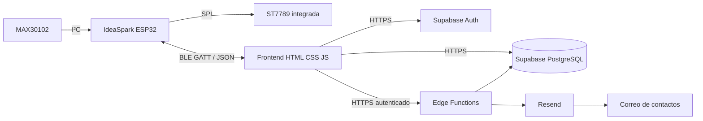

# 25 — Estado actual del proyecto y bitácora técnica

**Actualización documental:** 11 de octubre de 2026.  
**Aplicación web:** [Tomicasgit/Aplicacion_AMAR](https://github.com/Tomicasgit/Aplicacion_AMAR).  
**Firmware canónico:** [Tomicasgit/ESP32_Proyecto2030](https://github.com/Tomicasgit/ESP32_Proyecto2030).

Este documento registra el estado conocido a partir del código y los cambios descritos en el historial del proyecto. No convierte tareas pendientes en pruebas aprobadas.

## 1. Arquitectura vigente

- **Hardware/firmware:** lee el MAX30102, estima LPM, actualiza el dashboard TFT y expone telemetría por BLE. No usa Wi-Fi.
- **Frontend:** HTML, CSS y JavaScript estáticos, alojados mediante GitHub Pages. Web Bluetooth depende de un navegador compatible y contexto seguro.
- **Autenticación/persistencia:** Supabase Auth y PostgreSQL con políticas RLS.
- **SOS/correo:** Edge Functions del proyecto Supabase y Resend, si están desplegados y configurados.
- **Límite de alojamiento:** GitHub Pages publica archivos estáticos; no ejecuta PHP ni sirve una API propia del lado servidor.

## 2. Repositorios y fuente de verdad

| Componente | Repositorio / archivo | Fuente de verdad |
|---|---|---|
| Aplicación web | [Aplicacion_AMAR](https://github.com/Tomicasgit/Aplicacion_AMAR) | HTML, CSS, JS y funciones Supabase incluidas en este repo. |
| Firmware del dispositivo | [ESP32_Proyecto2030](https://github.com/Tomicasgit/ESP32_Proyecto2030/blob/main/Completop.ino) | `Completop.ino` v5.3, con la versión declarada dentro del sketch. |
| Documentación general | `README.md` y `docs/` de la app | Arquitectura global, instalación, UX, datos, seguridad y manuales. |
| Documentación del firmware | [Referencia completa v5.3](24-REFERENCIA-FIRMWARE-V5.3.md) | Descripción del sketch del repositorio de firmware. |

La copia `Completop.ino` que aparece en el repositorio web declara v4.1 y tiene un algoritmo anterior (umbral de dedo, sin la misma detección de contacto de muñeca/mediana de v5.3). No se debe editar una copia antigua pensando que cambia el dispositivo actual. Para modificar el firmware, trabajar en el repositorio de firmware y luego actualizar la documentación de ambos repositorios.

## 3. Aplicación web: funciones presentes en el código

El HTML actual define vistas de inicio de sesión, registro y panel. El panel incluye:
- frecuencia cardíaca actual y estado de lectura;
- hora de última lectura;
- resumen diario;
- historial con calendario mensual, resumen semanal/mensual y lecturas por día;
- vinculación del ESP32;
- lista de dispositivos;
- contactos de emergencia;
- ubicación más reciente si está disponible;
- última alerta;
- solicitud SOS.

Los módulos JavaScript están separados por responsabilidad:

| Archivo | Responsabilidad |
|---|---|
| `js/core.js` | Funciones compartidas de interfaz, modal, mensajes y DOM. |
| `js/auth.js` | Registro, inicio y cierre de sesión con Supabase Auth. |
| `js/profile.js` | Lectura/edición de perfil. |
| `js/devices.js` | CRUD de dispositivos. |
| `js/contacts.js` | CRUD de contactos de emergencia. |
| `js/history.js` | Historial, calendario y resúmenes. |
| `js/dashboard.js` | Carga de indicadores y listas del panel. |
| `js/alerts.js` | Flujo SOS, registro de alerta y ubicación opcional. |
| `js/bluetooth.js` | Web Bluetooth, telemetría, desconexión y persistencia de lecturas. |
| `app.js` | Coordinación de formularios y eventos de interfaz. |

Los nombres y detalles exactos deben cotejarse con los archivos actuales al realizar un cambio.

## 4. BLE y persistencia: etapas diferentes

El flujo de una lectura tiene varias etapas que no deben confundirse:

1. El sensor produce muestras.
2. El firmware acepta una estimación y la publica en la característica BLE.
3. El navegador recibe una notificación o lee la característica.
4. El parser valida el JSON y actualiza el panel.
5. Si hay usuario autenticado, lectura válida y permisos, la aplicación intenta insertar la fila en `heart_readings`.
6. El historial consulta las filas persistidas.

Una pantalla que diga “conectado” confirma solamente una parte del flujo. Si la web muestra “Conectado, esperando datos del sensor”, comprobar el JSON recibido, nombres de campos, notificaciones/lectura inicial y caché del JavaScript antes de atribuir el problema a Supabase. Si se ve la lectura pero no aparece en el historial, investigar inserción, `device_id`, sesión, red y RLS.

## 5. Cambios recientes registrados

### Firmware/dashboard

- Se estableció como fuente canónica el repositorio separado `ESP32_Proyecto2030`, cuyo sketch declara v5.3.
- El dashboard TFT del firmware canónico usa una estética clara con acento coral, encabezado A.M.A.R., tarjeta de LPM, promedio, calidad, estado del sensor, estado BLE y hora.
- La inicialización de pantalla ejecuta una prueba visual de colores y texto.
- La lógica del firmware v5.3 incorpora detección de contacto óptico con histéresis y confirmación temporal, lectura del FIFO, mediana de intervalos, suavizado exponencial, promedio reciente, expiración de lectura y estados separados.
- La telemetría incluye timestamp, LPM, promedio, estado del sensor, estado de usuario, calidad y alerta crítica.
- El firmware no usa Wi-Fi; la web sincroniza fecha/hora por BLE.

### Aplicación web

- La aplicación se mantiene como frontend HTML/CSS/JavaScript estático, con GitHub Pages como alojamiento.
- La comunicación con el dispositivo se realiza mediante Web Bluetooth.
- Se incorporó/ajustó la persistencia de lecturas con `device_id`, reintentos tras errores y procesamiento de paquetes BLE repetidos para evitar depender de una única notificación.
- Se actualizaron versiones de scripts/recursos para reducir problemas de caché tras cambios.
- En contactos se retiró el botón local de correo; la dirección de correo del contacto sigue siendo parte de los datos utilizados por el flujo SOS del servidor.
- El flujo de SOS depende de Edge Functions y de la configuración de Resend para los correos.

Los cambios anteriores describen trabajo registrado; las pruebas físicas y de extremo a extremo deben anotarse por separado.

## 6. Modelo de datos observado

El cliente y las funciones hacen referencia a estas tablas. La existencia, los tipos exactos, índices, restricciones y políticas activas deben confirmarse en el proyecto Supabase real.

| Tabla | Uso |
|---|---|
| `profiles` | Datos del perfil. |
| `devices` | Dispositivos vinculados al usuario. |
| `emergency_contacts` | Nombre, teléfono, correo y relación del contacto. |
| `heart_readings` | Lecturas, usuario/dispositivo y tiempo. |
| `locations` | Ubicaciones obtenidas con permiso. |
| `alerts` | Solicitudes SOS manuales/automáticas y estado. |

RLS debe limitar las filas privadas al propietario correspondiente. Un filtro en JavaScript no es una medida de seguridad suficiente.

## 7. SOS y correo

El SOS de la web registra la alerta mediante una función del servidor y puede solicitar correos a los contactos, según la configuración. La aceptación de una solicitud por Resend no garantiza que el mensaje llegue a la bandeja, sea leído o produzca una respuesta.

Los secretos `RESEND_API_KEY` y `RESEND_FROM_EMAIL` deben configurarse como secretos del entorno Supabase. No deben estar en HTML, JavaScript público ni documentación. Los enlaces `tel:` o WhatsApp abren una acción para que el usuario continúe; no significan que la aplicación haya completado una llamada o enviado un mensaje.

## 8. Estado de verificación

### Documentado en el código

- La arquitectura de frontend estático y Supabase.
- El contrato de telemetría del firmware v5.3.
- Los UUID BLE y estados del sensor.
- El algoritmo de estimación y los parámetros actuales.
- Los módulos principales de la aplicación y las tablas consultadas por el código.

### Requiere evidencia del entorno real

- Compilación del sketch v5.3 con el core/bibliotecas elegidos.
- Carga y funcionamiento del dashboard en la placa física.
- Calidad y estabilidad de la señal del MAX30102 en condiciones de uso.
- Notificaciones y lectura BLE en el navegador objetivo.
- Sincronización de fecha/hora de extremo a extremo.
- Esquema exacto y políticas RLS de Supabase.
- Versión de Edge Functions realmente desplegada.
- Envío y entrega de correo de extremo a extremo.
- Pruebas móviles reales y accesibilidad.
- Resultado completo de CRUD e historial en el entorno publicado.

No afirmar que estas pruebas pasaron hasta registrar fecha, versión/commit, pasos, resultado observado y evidencia.

## 9. Seguridad, privacidad y alcance médico

- Utilizar datos ficticios en pruebas y capturas.
- No almacenar claves privadas, tokens, credenciales ni coordenadas en el repositorio.
- Solicitar permiso antes de acceder a ubicación.
- Aplicar RLS y validación en el servidor.
- Informar qué datos se envían en una solicitud SOS.
- No usar la calidad heurística o los rangos de alerta como diagnóstico.
- No considerar el correo una vía garantizada de emergencia.
- El proyecto es un prototipo académico, no un dispositivo médico certificado.

## 10. Pendientes técnicos prioritarios

1. Registrar una compilación reproducible de firmware y su resultado.
2. Ejecutar pruebas físicas de TFT, sensor y BLE y adjuntar evidencia sin datos personales.
3. Confirmar que la aplicación interpreta el JSON v5.3 exactamente.
4. Verificar persistencia de `heart_readings` y asociación de `device_id`.
5. Exportar/documentar el esquema real y las políticas RLS de Supabase.
6. Confirmar el despliegue de Edge Functions y la configuración de Resend.
7. Probar estados de desconexión, dato obsoleto, reconexión y caché de frontend.
8. Mantener sincronizados los UUID y el contrato JSON entre repositorios.
9. Evitar que la copia histórica v4.1 se confunda con el firmware canónico v5.3.

## 11. Plantilla de bitácora

Para cada nueva sesión de trabajo:

- Fecha:
- Repositorio y rama:
- Commit:
- Archivos modificados:
- Motivo:
- Entorno/placa/navegador:
- Pasos de prueba:
- Resultado esperado:
- Resultado observado:
- Evidencia:
- Pendientes y responsable:
